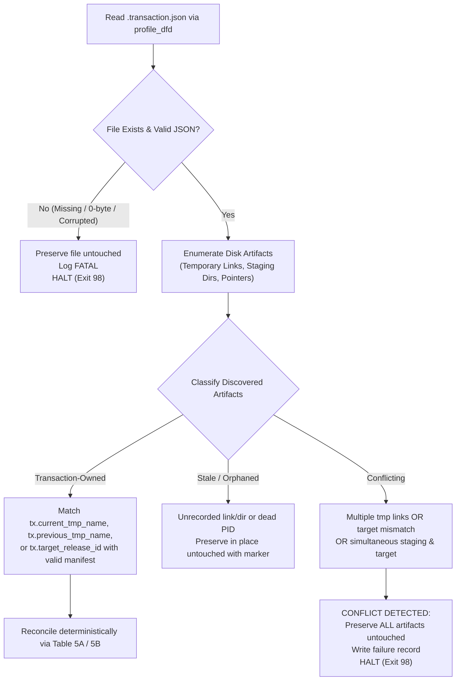

# Linkx Frontend — Multi-Profile Release & Deployment Architecture Handoff

**Document Identifier:** `LINKX_RELEASE_ARCHITECTURE_HANDOFF.md`  
**Canonical File Location:** `/var/www/linkx-frontend/doc/LINKX_RELEASE_ARCHITECTURE_HANDOFF.md`  
*(Note on Canonical Path: In task descriptions and engineering prompts, this authoritative specification is frequently cited as `/var/www/linkx-frontend/LINKX_RELEASE_ARCHITECTURE_HANDOFF.md`. The single canonical file in the repository is located at `/var/www/linkx-frontend/doc/LINKX_RELEASE_ARCHITECTURE_HANDOFF.md`, as referenced by line 5 of `release_manager.sh` and `test_release_manager.sh`. No duplicate file exists in the repository root.)*  
**Date:** 2026-10-26  
**Status:** Canonical Project Handoff & Architecture Baseline Reference  
**Current Phase:** Gate 4E Completed in Isolated Test Fixture (Agent-Reported Validation Suites 1–6 Passed 47/47; Stage 5 Production Deployment Strictly Unauthorized)  
**Production Changes Executed:** Empty base release root `/var/www/linkx-releases` provisioned (owner `uadmin:www-data`, mode `0755`, verified 100% empty). Zero production releases, production symlinks, or Nginx cutovers executed.  
**Authorization Status:** Gate 4E fixture testing completed in isolated test fixture `run_20261026_083445`. Stage 5 production release directory provisioning, production deployment, and Nginx cutover remain **STRICTLY UNAUTHORIZED PENDING EXPLICIT OPERATOR APPROVAL**.

---

> [!IMPORTANT]
> ### Mandatory Starting Reference for All Future Engineering Tasks
> This document is the **single authoritative reference** for Linkx frontend deployment and release engineering.
> Any engineer or autonomous agent performing work on this repository **MUST**:
> 1. Consult this handoff file before executing any deployment-related action.
> 2. Strictly adhere to all non-negotiable architectural invariants and safety constraints defined herein.
> 3. Maintain `/var/www/linkx-frontend` as the sole canonical source checkout (never clone, move, or duplicate).
> 4. Never overwrite restored CDR content or move/delete existing backups.
> 5. Update this file with all new verified facts, architectural decisions, and task progress upon completion of every task.

---

## 1. Project Purpose & Architecture Goals

Linkx is an enterprise visual investigation and link analysis platform developed in React 19 and Vite. The frontend application supports multiple distinct domain profiles from a single unified codebase:
1. **CDR Telecom Profile (`cdr`)**: Telecom terminology (Caller/Callee MSISDN, Call Duration, Cell Towers, IMEI/IMSI), 18 telecom detection rules, 17 fraud typologies, duration volume tiers, and sky-blue/navy branding (`/linkxCDR2026/`).
2. **NBE / BDR Banking Profile (`nbe`)**: Financial link analysis (Account numbers, transfer amounts in Birr, transaction dates), AML detection typologies, and gold/bronze branding (`/linkxDS2026/`).

### Architectural Goals:
* **Independent Domain Releases:** CDR and NBE/BDR must be independently deployable and upgradeable. Promoting a new CDR release must never modify, rebuild, or disrupt the active NBE/BDR release.
* **POSIX-Atomic Promotion:** New versions must be promoted instantaneously without leaving live users with missing or partially built bundles.
* **Deterministic Per-Domain Rollback:** If a defect is discovered in a deployed profile, operators must be able to roll back that specific domain in $< 100\text{ ms}$ without rebuilding from source.
* **Safe Release Retention:** Store the active release plus up to five prior releases per profile with strict path constraints, never deleting active, previous, or in-progress releases.
* **Non-Destructive Operations:** Protect production environment configurations and eliminate legacy destructive commands (`git reset --hard`, `git clean -fd`).

---

## 2. Canonical Architecture & Source-of-Truth Paths

### A. Architectural Boundary & Separation of Concerns

```
/var/www/
├── linkx-frontend/                              [CANONICAL SOURCE CHECKOUT — SOLE WORKING TREE]
│   ├── src/                                     [React 19 source code]
│   ├── public/                                  [Vite public asset templates]
│   ├── package.json, package-lock.json          [Dependency definitions]
│   ├── vite.config.js                           [Vite multi-profile build config]
│   ├── deploy.sh                                [Non-destructive deployment CLI — Proposed Task 4]
│   ├── rollback.sh                              [Deterministic rollback CLI — Proposed Task 4]
│   └── doc/LINKX_RELEASE_ARCHITECTURE_HANDOFF.md [This authoritative handoff reference]
│
└── linkx-releases/                              [DEDICATED RELEASES TREE — TO BE PROVISIONED]
    │
    ├── live/                                    [STABLE WEBSERVER ROOT SERVED BY NGINX]
    │   ├── linkxCDR2026 -> /var/www/linkx-releases/cdr/current   [STABLE SYMLINK — NEVER REPOINTED]
    │   └── linkxDS2026  -> /var/www/linkx-releases/nbe/current   [STABLE SYMLINK — NEVER REPOINTED]
    │
    ├── cdr/                                     [CDR TELECOM PROFILE SUBTREE]
    │   ├── .deploy.lock                         [Exclusive flock mutex file for CDR operations]
    │   ├── .transaction.json                    [In-flight durable state; absent in steady state]
    │   ├── .transaction.last.json               [Audit record of last completed transaction]
    │   ├── releases.json                        [Append-only historical ledger of CDR releases]
    │   ├── current -> releases/<release_id>     [Active CDR release symlink (swapped atomically)]
    │   ├── previous -> releases/<prior_id>      [Immediately preceding valid release symlink]
    │   └── releases/                            [CDR Immutable Release Store]
    │       ├── baseline_20261023/               [Seeded from live /linkxCDR2026 — preserved on disk]
    │       │   ├── index.html                   [Active entrypoint (assets/index-CDMe3Ahg.js)]
    │       │   ├── assets/                      [Compiled JS/CSS bundles]
    │       │   ├── graph_icons/                 [116 clean SVG icons]
    │       │   ├── libraries/                   [vis-network, jspdf, etc.]
    │       │   ├── site_images/, site_videos/   [Static media]
    │       │   ├── thumbnails/, temp_placeholders/ [Public static assets]
    │       │   ├── temp_config/, temp_rules/    [Telecom rule definitions]
    │       │   └── release_manifest.json        [SHA256 checksums, build provenance metadata]
    │       └── <release_id>/                    [Immutable timestamped release directory]
    │
    └── nbe/                                     [NBE / BDR BANKING PROFILE SUBTREE]
        ├── .deploy.lock                         [Exclusive flock mutex file for NBE operations]
        ├── .transaction.json                    [In-flight durable state; absent in steady state]
        ├── .transaction.last.json               [Audit record of last completed transaction]
        ├── releases.json                        [Append-only historical ledger of NBE releases]
        ├── current -> releases/<release_id>     [Active NBE release symlink (swapped atomically)]
        ├── previous -> releases/<prior_id>      [Immediately preceding valid release symlink]
        └── releases/                            [NBE Immutable Release Store]
            ├── baseline_20261023/               [Seeded from live /linkxDS2026 — preserved on disk]
            │   ├── index.html                   [Active entrypoint (assets/index-B8LLmIoZ.js)]
            │   ├── assets/                      [Compiled JS/CSS bundles]
            │   ├── ... (all static directories) [Identical self-contained layout]
            │   └── release_manifest.json
            └── <release_id>/
```

### B. Precise Symlink Target Specifications
1. **Stable Web Roots (`live/`):**
   * `/var/www/linkx-releases/live/linkxCDR2026` targets strictly `/var/www/linkx-releases/cdr/current`.
   * `/var/www/linkx-releases/live/linkxDS2026` targets strictly `/var/www/linkx-releases/nbe/current`.
   * *Status:* **Static and Permanent.** These symlinks are provisioned once and are **never repointed** during deployments or rollbacks.
2. **Profile Active Pointers (`current`):**
   * `/var/www/linkx-releases/<profile>/current` targets `/var/www/linkx-releases/<profile>/releases/<release_id>`.
   * Traversed by Nginx via `live/linkxCDR2026` or `live/linkxDS2026`.
3. **Profile Previous Pointers (`previous`):**
   * `/var/www/linkx-releases/<profile>/previous` targets `/var/www/linkx-releases/<profile>/releases/<prior_release_id>`.
   * On initial baseline release (Release 0), `previous` does not exist; it is established on the first promotion.
4. **History & Domain Isolation:**
   * CDR release operations are confined strictly to `/var/www/linkx-releases/cdr/`.
   * NBE release operations are confined strictly to `/var/www/linkx-releases/nbe/`.
   * Cross-profile access or shared release directories are strictly prohibited.

---

## 3. Production State, Preserved Data & Backups

### A. Current Production Serving Configuration
* **Active Nginx Server Configuration File:** `/etc/nginx/sites-available/linkx-frontend` (enabled via symlink in `/etc/nginx/sites-enabled/linkx-frontend`).
* **Active Virtual Host:** Single default server (`server_name _;`) handling port 80 (HTTP $\rightarrow$ HTTPS 301 redirect) and port 443 (SSL/TLS HTTP/2).
* **Current Web Roots Served (Directly from Source Checkout):**
  * Line 29: `location = /auth/callback { root /var/www/linkx-frontend; try_files /linkxDS2026/index.html =404; }`
  * Line 42: `location ^~ /linkxCDR2026/ { root /var/www/linkx-frontend; index index.html; try_files $uri $uri/index.html /linkxCDR2026/index.html; }`
  * Line 48: `location ^~ /linkxDS2026/ { root /var/www/linkx-frontend; index index.html; try_files $uri $uri/index.html /linkxDS2026/index.html; }`
* **Upstream Backend Proxies:**
  * Line 53: `location /api/ { proxy_pass http://172.27.23.95:8000; ... }`
  * Line 66: `location /socket.io/ { proxy_pass http://172.27.23.95:8001; ... }`

### B. Preserved Data & Backup Integrity Rules
* **Distinction: Source Inputs vs Preserved Deployed Content:**
  * **Tracked Source Inputs:** `src/`, `public/`, `package.json`, `package-lock.json`, `vite.config.js`, `index.html`. These files represent the compilation source and are verified 100% clean in Git (`git status --porcelain` returns empty).
  * **Preserved Deployed Content:** `/var/www/linkx-frontend/linkxCDR2026/` (87 MB) and `/var/www/linkx-frontend/linkxDS2026/` (143 MB). These directories contain restored production bundles currently served by Nginx. They contain local CRLF line-ending differences in `index.html`.
  * **Non-Destructive Precondition Invariant:** **Preserved deployed content must NEVER be stashed, reset, cleaned, or overwritten to satisfy a "clean worktree" check.** Automated tools and operators must never execute blanket `git checkout .`, `git reset --hard`, or `git clean -fd`.
* **Verified Active Bundle Hashes on Disk:**
  * CDR Telecom Script Bundle: `/var/www/linkx-frontend/linkxCDR2026/assets/index-CDMe3Ahg.js` (`SHA256: fc2c71bafffd448903026817a4dcb99774ce8234db58bf4e3ee0af2a3ee88c43`)
  * CDR Telecom Style Bundle: `/var/www/linkx-frontend/linkxCDR2026/assets/index-DrhqR0ci.css` (`SHA256: af21a1b1fb849bfb4af59b03d7bf51f8d91a9f7416f29188c527fa4b777c7918`)
  * DS Banking Script Bundle: `/var/www/linkx-frontend/linkxDS2026/assets/index-B8LLmIoZ.js` (`SHA256: eed25ccf6f7f12a7a672f8431d91b772d936ca12e89d1d9dfe80e405df454c4b`)
  * DS Banking Style Bundle: `/var/www/linkx-frontend/linkxDS2026/assets/index-DrhqR0ci.css` (`SHA256: af21a1b1fb849bfb4af59b03d7bf51f8d91a9f7416f29188c527fa4b777c7918`)
* **Preserved Backups:**
  * `/var/www/linkx-frontend/deploy_pkg_172.21.13.73/`: Pre-packaged bundle for remote host. **MUST NEVER be deleted, moved, or altered**.
* **Incubation Directory Safety:**
  * `/var/www/linkx-frontend/incubation/`: Reserved for future projects. **STRICT PROJECT INVARIANT: Never read, touch, search, or modify anything inside `incubation/`.**
* **Local Git Working Tree State:**
  * Single canonical checkout: `/var/www/linkx-frontend`
  * Branch: `main` (commit `f342254541a075ec9e461eee747142eca6ca2f5b`)
  * Modified tracked files: `linkxCDR2026/index.html` and `linkxDS2026/index.html` (CRLF line-ending differences from prior local builds).
  * Tracked caches: `node_modules/` contains tracked build caches from local development.
  * Clean source code: `src/`, `public/`, `package.json`, `package-lock.json`, `vite.config.js`, and `index.html` have **zero uncommitted changes**.
  * Safety rule: Destructive Git commands (`git reset --hard`, `git clean -fd`, `git checkout .`) are **STRICTLY PROHIBITED**.

---

## 4. Confirmed Facts and Evidence (with Verification Methods)

To enforce strict evidence discipline, operational evidence is rigorously partitioned into four distinct epistemological classifications:
1. **Fresh Read-Only Observed Facts:** Direct, empirical observations verified during Task 4A / 4A.1 preflight on host `node-18` (`172.27.23.21`).
2. **Prior Reported Observations:** Historical operational facts established and reported during Tasks 1 through 3F.
3. **Design Assumptions:** Architectural and behavioral premises adopted for system modeling.
4. **Unresolved Questions & Configuration Blockers:** Known technical blockers requiring external human operator input before execution.

---

### A. Fresh Read-Only Observed Facts (Task 4A / 4A.1 Preflight — 2026-10-23)

| Category | Fact / Parameter | Concrete Verified Evidence & Value | Verification Command | Exit Code |
|---|---|---|---|---|
| **User & Privileges** | Execution User | User `uadmin` (`uid=1000`, `gid=1000`). | `id` | `0` |
| **User & Privileges** | Web Server Group | Group `www-data:x:33:` exists on host. | `getent group www-data` | `0` |
| **User & Privileges** | Sudo Access | Passwordless sudo is verified and active. | `sudo -n true` | `0` |
| **Storage & Filesystem** | Filesystem Mount | `/dev/vda1` mounted at `/`. | `df -h /var/www/linkx-frontend` | `0` |
| **Storage & Filesystem** | Available Capacity | **179 GB available** (14 GB used, 8% utilization). | `df -h /var/www` | `0` |
| **Storage & Filesystem** | Inode Utilization | **25.8 million free inodes** (1% utilization). | `df -i /var/www` | `0` |
| **Storage & Filesystem** | Same Filesystem | `/var/www/linkx-frontend` and `/var/www/linkx-releases` share `/dev/vda1`. | `stat -c "%m %d" /var/www` | `0` |
| **Release Root** | Release Parent Path | `/var/www/linkx-releases` exists, owned by `uadmin:www-data` (`1000:33`), mode `0755` (`drwxr-xr-x`), device `64769`, inode `3148413`, **100% empty (0 subentries)**. | `stat` and `find /var/www/linkx-releases -mindepth 1` | `0` |
| **Host Kernel** | Linux Kernel Release | Linux `6.8.0-124-generic` (`x86_64`). Meets Linux 5.6+ requirement. | `uname -r` | `0` |
| **Kernel Syscall** | `openat2` Syscall Support | Syscall 437 with `RESOLVE_BENEATH` probe functional (`fd=5`). | Python 3.12 ctypes probe | `0` |
| **Git Working Tree** | Canonical Head Commit | Commit `f342254541a075ec9e461eee747142eca6ca2f5b` (`main`). | `git rev-parse HEAD` | `0` |
| **Git Working Tree** | Git Stash State | Stash is completely empty. | `git stash list` | `0` (Empty) |
| **Working Tree Scope** | Whole Repository State | **Repository-wide working tree is NOT clean.** `git status --porcelain` shows diffs in active bundles (`linkxCDR2026/`, `linkxDS2026/`), tracked `node_modules/` build cache, and untracked `doc/`. | `git status --porcelain` | `0` |
| **Working Tree Scope** | Selected Source Inputs | Only the specific compilation inputs (`src/`, `public/`, `package.json`, `package-lock.json`, `vite.config.js`, `index.html`) are **100% clean (0 uncommitted changes)**. | `git diff --quiet -- src public package.json package-lock.json vite.config.js index.html` | `0` |
| **Preserved Content** | Preserved Active Deployed | `linkxCDR2026/index.html` & `linkxDS2026/index.html` modified due to CRLF line endings. Preserved untouched. | `git status --porcelain` | `0` |
| **Active Bundles** | CDR Script Bundle Hash | `assets/index-CDMe3Ahg.js` (746,848 bytes)<br>`fc2c71bafffd448903026817a4dcb99774ce8234db58bf4e3ee0af2a3ee88c43` | `sha256sum` | `0` |
| **Active Bundles** | CDR Style Bundle Hash | `assets/index-DrhqR0ci.css` (439,990 bytes)<br>`af21a1b1fb849bfb4af59b03d7bf51f8d91a9f7416f29188c527fa4b777c7918` | `sha256sum` | `0` |
| **Active Bundles** | DS Script Bundle Hash | `assets/index-B8LLmIoZ.js` (746,841 bytes)<br>`eed25ccf6f7f12a7a672f8431d91b772d936ca12e89d1d9dfe80e405df454c4b` | `sha256sum` | `0` |
| **Active Bundles** | DS Style Bundle Hash | `assets/index-DrhqR0ci.css` (439,990 bytes)<br>`af21a1b1fb849bfb4af59b03d7bf51f8d91a9f7416f29188c527fa4b777c7918` | `sha256sum` | `0` |
| **Preserved Backups** | Remote Deploy Package | `/var/www/linkx-frontend/deploy_pkg_172.21.13.73/` intact. | `ls -ld deploy_pkg_172.21.13.73` | `0` |
| **Incubation Safety** | Incubation Path | `/var/www/linkx-frontend/incubation/` intact, isolated, and strictly untouched. | Path invariant check | `0` |

> [!CAUTION]
> ### Strict Non-Broadening Evidence Discipline: Clean Source Inputs $\neq$ Clean Whole Repository
> The factual finding that **selected tracked source inputs** (`src/`, `public/`, `package.json`, `package-lock.json`, `vite.config.js`, `index.html`) have zero uncommitted changes must **NEVER be broadened into a claim that the "whole repository is clean" or the "working tree is clean"**.
> 1. `git status --porcelain` reveals modified files in preserved active production directories (`linkxCDR2026/index.html`, `linkxDS2026/index.html` due to CRLF formatting), repository-tracked local build caches (`node_modules/`), and untracked documentation (`doc/`).
> 2. Automated scripts and engineers **MUST NEVER** enforce whole-repository checks (e.g. bare `git diff --quiet` or asserting empty `git status --porcelain`).
> 3. Enforcing a whole-repository cleanliness check creates an extreme operational hazard: operators or scripts would be tempted to execute destructive commands (`git reset --hard`, `git checkout .`, `git clean -fd`), which would instantly obliterate the active restored production bundles currently served by Nginx. Preflight validation must strictly assert cleanliness ONLY against the explicit source inputs allowlist.

---

### B. Prior Reported Observations (Historical Context from Earlier Stages)

1. **TLS Certificate Expiration:** Certificate (`/etc/nginx/certs/linkx.crt`) has subject `CN = 172.27.23.21` and expired on August 2, 2026. Local verification probes require certificate-unverified flags (`curl -k`).
2. **Nginx Web Server Routing:** Current configuration `/etc/nginx/sites-available/linkx-frontend` serves both profiles directly from `/var/www/linkx-frontend/linkxCDR2026/` and `/var/www/linkx-frontend/linkxDS2026/` while reverse proxying `/api/` to `http://172.27.23.95:8000` and `/socket.io/` to `http://172.27.23.95:8001`.
3. **Static Asset Identity:** The 8 static asset directories (`graph_icons/`, `libraries/`, etc.) in `linkxCDR2026/` and `linkxDS2026/` were verified byte-for-byte identical via `diff -r`.
4. **Vite Build Precedence:** In `vite.config.js`, environment variables passed via shell execution environment (`process.env`) override `.env` file values loaded via `loadEnv()`.

---

### C. Design Assumptions

1. **Cooperative Profile Mutual Exclusion:** Assumes operations within a profile (`cdr` or `nbe`) are serialized by an exclusive non-blocking `flock(LOCK_EX)` on `.deploy.lock`. Uncoordinated external processes modifying files outside this lock represent an out-of-scope external threat.
2. **POSIX Filesystem Atomicity:** Assumes the underlying ext4 filesystem on `/dev/vda1` conforms to POSIX semantics for `renameat2()`, guaranteeing that directory and symlink replacements are atomic with respect to path lookup.
3. **Pure Client SPA Execution:** Assumes the frontend build produces entirely static artifacts (HTML, JS, CSS, SVG) requiring no persistent runtime writable directories or backend state storage in the release tree.
4. **Content-Addressable Asset Cache Invalidation:** Assumes modern browser clients invalidate asset caches based on unique hash suffixes generated by Vite during bundling (`assets/index-<hash>.js`).

---

### D. Unresolved Questions & Configuration Blockers

1. **Blocker D-1 (Local CDR Build on Node-18):** Node-18 lacks a production-ready `.env` for CDR. The repository `.env` defines `VITE_THEME=nbe`. The template `.env.cdr` contains unresolved placeholders (`CDR_SERVER_IP`, `CDR_PARENT_PROJECT_IP`). Borrowing `.env` from `deploy_pkg_172.21.13.73/` is strictly prohibited because it targets remote host `172.21.13.73`. **Local CDR compilation on node-18 is unconditionally blocked until an operator supplies `--env-file <path>`.**
2. **Blocker D-2 (CRLF Line Endings in Tracked HTML):** Tracked files `linkxCDR2026/index.html` and `linkxDS2026/index.html` contain CRLF line ending differences from prior builds. Git preflight checks in the release manager must permit `--allow-dirty` for these specific preserved files while asserting 100% cleanliness across core source files (`src/`, `public/`, `package.json`, `vite.config.js`).
3. **Blocker D-3 (Self-Signed Expired SSL):** Verification probes over loopback HTTPS require `--insecure` / `-k` to avoid premature aborts on SSL certificate expiry.

---

## 5. Deployment, Build, Release, Rollback, Recovery, Durability & Retention Requirements

### A. Complete Recovery Decision Tables

A transaction is identified strictly by `/var/www/linkx-releases/<profile>/.transaction.json`.
* **Ambiguity Invariant:** If transaction ownership, phase, or filesystem state is ambiguous or inconsistent with recorded intent, the engine **MUST NOT guess or alter symlinks**. It preserves all state files and symlinks in place and **STOPS IMMEDIATELY for operator intervention**.
* **Unexpected Current Symlink Invariant:** The recovery engine **MUST NEVER automatically overwrite an unexpected `current` target**. If `current` points to a release other than `old_active` or `target_id`, the engine halts immediately.

#### Table 5A: Deployment Transaction Recovery Matrix (`action: "deploy"`)
* Target release: $T = \text{target\_release\_id}$
* Active release before deployment: $A = \text{old\_active\_id}$
* Previous release before deployment: $P = \text{old\_previous\_id}$ (may be `null` if baseline)

| Recorded Phase | Target Dir ($T$) | Old Active Dir ($A$) | Observed `current` Target | Observed `previous` Target | Observed Temporary Symlinks | Exactly One Safe Recovery Action |
|---|---|---|---|---|---|---|
| **`STAGING`** | Staging exists (`T.staging`), $T$ missing | Exists | Points to $A$ | Points to $P$ (or none) | None | Staging build interrupted. Preserve `T.staging` in place with `.staging_interrupted` marker (ZERO deletion). Archive `.transaction.json` to `.transaction.failed.json`. Live traffic on $A$ is 100% unaffected. |
| **`STAGING`** | Any other combination | Any | Any | Any | Any | Inconsistent staging state. **STOP for operator intervention.** |
| **`FINALIZING`** | Staging exists (`T.staging`), $T$ missing | Exists | Points to $A$ | Points to $P$ (or none) | None | Staging directory rename did not execute. Preserve `T.staging` in place with `.rename_interrupted` marker (ZERO deletion). Preserve `.transaction.json`. Traffic on $A$ unaffected. |
| **`FINALIZING`** | $T$ exists, `T.staging` missing | Exists | Points to $A$ | Points to $P$ (or none) | None | Staging rename succeeded; state write failed. Advance state to `FINALIZED`. Resume from Step 3. |
| **`FINALIZING`** | Both exist or $T$ missing | Any | Any | Any | Any | Inconsistent directory state. **STOP for operator intervention.** |
| **`FINALIZED`** | Exists | Exists | Points to $A$ | Points to $P$ (or none) | None | Directory finalized; symlinks untouched. Live traffic safe on $A$. Recovery deterministically advances to Step 3 (`UPDATING_PREVIOUS`) to complete deployment. |
| **`UPDATING_PREVIOUS`** | Exists | Exists | Points to $A$ | Points to $P$ (or none) | `previous.tmp.*` exists | Crash before atomic swap. Preserve `previous.tmp.*` in place (ZERO deletion). Re-execute atomic swap `previous` $\rightarrow$ $A$. Advance to `PREVIOUS_UPDATED`. |
| **`UPDATING_PREVIOUS`** | Exists | Exists | Points to $A$ | Points to $A$ | None or stale `tmp` | Crash after atomic swap. Preserve any existing `tmp` link in place. Advance state to `PREVIOUS_UPDATED`. |
| **`UPDATING_PREVIOUS`** | Any | Any | Does NOT point to $A$ | Any | Any | **UNEXPECTED CURRENT TARGET.** Current symlink was modified outside transaction. **STOP for operator intervention.** |
| **`PREVIOUS_UPDATED`** | Exists | Exists | Points to $A$ | Points to $A$ | None | `previous` updated; `current` untouched. Live traffic unaffected. Resume Step 4 (cutover `current`) or abort by restoring `previous` $\rightarrow$ $P$. |
| **`UPDATING_CURRENT`** | Exists | Exists | Points to $A$ | Points to $A$ | `current.tmp.*` exists | Crash before atomic cutover. Preserve `current.tmp.*` in place (ZERO deletion). Re-execute atomic swap `current` $\rightarrow$ $T$. Advance to `CURRENT_UPDATED`. |
| **`UPDATING_CURRENT`** | Exists | Exists | Points to $T$ | Points to $A$ | None or stale `tmp` | Crash after atomic cutover. Preserve any existing `tmp` link in place. Advance state to `CURRENT_UPDATED`. |
| **`UPDATING_CURRENT`** | Any | Any | Points to neither $A$ nor $T$ | Any | Any | **UNEXPECTED CURRENT TARGET.** Symlink corrupted or redirected. **STOP for operator intervention.** |
| **`CURRENT_UPDATED`** | Exists | Exists | Points to $T$ | Points to $A$ | None | Cutover complete. Advance state to `VERIFYING`. Execute post-promotion static health checks. |
| **`VERIFYING`** | Exists | Exists | Points to $T$ | Points to $A$ | None | Crash during health check execution. Re-execute static health checks under lock.<br>• *Pass:* Advance to `VERIFIED`.<br>• *Fail:* Advance to `ROLLING_BACK`. |
| **`ROLLING_BACK`** | Exists | Exists | Points to $T$ | Points to $A$ | `current.tmp.*` exists | Crash before rollback cutover. Atomically swap `current` $\rightarrow$ $A$. Advance to `TRAFFIC_RESTORED`. |
| **`ROLLING_BACK`** | Exists | Exists | Points to $A$ | Points to $A$ | None or stale `tmp` | Crash after rollback cutover. Clean stale `tmp`. Advance to `TRAFFIC_RESTORED`. |
| **`ROLLING_BACK`** | Any | Missing ($A$ missing) | Any | Any | Any | **EMERGENCY: ROLLBACK RESTORATION TARGET MISSING.** Refuse to modify `current`. **STOP for operator intervention.** |
| **`TRAFFIC_RESTORED`** | Exists | Exists | Points to $A$ | Points to $A$ | None | Traffic restored to $A$. If $P$ exists on disk: atomically swap `previous` $\rightarrow$ $P$ (else unlink `previous`). Advance to `PREVIOUS_RESTORED`. |
| **`PREVIOUS_RESTORED`** | Exists | Exists | Points to $A$ | Points to $P$ (or none) | None | Neither `current` nor `previous` nor `live/` points to $T$. Assert zero references to $T$. Rename: `mv releases/T releases/T.failed_<ts>`. Advance to `ROLLED_BACK`. |
| **`ROLLED_BACK`** | Quarantined (`.failed_*`) | Exists | Points to $A$ | Points to $P$ (or none) | None | Append rollback incident to `releases.json`. Archive `.transaction.json` to `.transaction.last.json`. Unlock and exit 1. |
| **`VERIFIED`** | Exists | Exists | Points to $T$ | Points to $A$ | None | Promotion verified. Advance to `COMMITTING`: append release to `releases.json`, prune retention, archive `.transaction.json`. |
| **`COMMITTING`** | Exists | Exists | Points to $T$ | Points to $A$ | None | Crash during ledger update or pruning. Sync ledger idempotently, complete pruning, archive `.transaction.json`. |

---

#### Table 5B: Explicit Rollback Transaction Recovery Matrix (`action: "rollback"`)
* **Durable Transaction Context Schema:**
  The state file `.transaction.json` durably records exact artifact names rather than relying on PID or wildcard patterns:
  * `action`: `"rollback"`
  * `transaction_id`: `"tx_YYYYMMDD_HHMMSS_<rand>"`
  * `demoted_active_id`: $C$ (path: `releases/<C>`)
  * `target_restore_id`: $R$ (path: `releases/<R>`)
  * `expected_previous_target`: $E$ (equals $H$ if `quarantine_demoted == true`, else $C$)
  * `current_tmp_name`: exact staged link name (e.g. `"current.tmp.tx_20261023_114500_7a9f"`)
  * `current_tmp_target`: exact relative path `"releases/<R>"`
  * `previous_tmp_name`: exact staged link name (e.g. `"previous.tmp.tx_20261023_114500_7a9f"`)
  * `previous_tmp_target`: exact relative path `"releases/<E>"`
  * `quarantine_demoted`: `true` | `false`
* **Evidence-Preserving Failure Handling:**
  * When a rollback is aborted or halted due to an anomaly, failure details are appended to the state object, flushed via `fsync()`, and atomically renamed to `.transaction.failed.<transaction_id>.json`. It is **NEVER deleted or unlinked**.
  * If `.transaction.json` is 0 bytes or unparseable, it is left completely untouched in place at `.transaction.json` so the raw bytes are preserved for operator inspection. Recovery halts immediately.
* **Deterministic Rule:** Recovery must strictly execute the single permitted recovery action defined for each state. **If observed state does not match exactly one valid case, recovery MUST HALT IMMEDIATELY with zero pointer mutations.** No discretionary alternatives are permitted.

| Durable Recorded Phase | Observed `current` Target | Observed `previous` Target | Exact Permitted Temporary Symlink Validation | Single Permitted Deterministic Recovery Action |
|---|---|---|---|---|
| **`ROLLBACK_INITIALIZING`** | Points to $C$ | Points to $R$ | None permitted | Preflight interrupted before mutations. Archive `.transaction.json` to `.transaction.failed.<tx_id>.json`. Leave pointers untouched. Traffic safe on $C$. |
| **`ROLLBACK_INITIALIZING`** | Any other target | Any | Any | Inconsistent pre-rollback state. **EMERGENCY HALT (Zero mutations).** Stop for operator. |
| **`ROLLBACK_SWAPPING_CURRENT`** | Points to $C$ | Points to $R$ | Exact link `tx.current_tmp_name` exists and targets `tx.current_tmp_target` | First swap interrupted before rename. Resume intended swap: `renameat2(profile_dfd, tx.current_tmp_name, profile_dfd, "current", 0)` and `fsync(profile_dfd)`. Advance phase to `ROLLBACK_CURRENT_SWAPPED`. |
| **`ROLLBACK_SWAPPING_CURRENT`** | Points to $R$ | Points to $R$ | Any / None | First swap committed; state write interrupted. Leave `current` on $R$. Advance phase to `ROLLBACK_CURRENT_SWAPPED`. |
| **`ROLLBACK_SWAPPING_CURRENT`** | Points to neither $C$ nor $R$ | Any | Any | Unexpected active pointer. **EMERGENCY HALT (Zero mutations).** Stop for operator. |
| **`ROLLBACK_CURRENT_SWAPPED`** | Points to $R$ | Points to $R$ | None expected | First swap complete; second swap not begun. Advance phase to `ROLLBACK_SWAPPING_PREVIOUS`. |
| **`ROLLBACK_CURRENT_SWAPPED`** | Any other target | Any | Any | Pointer drift. **EMERGENCY HALT (Zero mutations).** Stop for operator. |
| **`ROLLBACK_SWAPPING_PREVIOUS`**| Points to $R$ | Points to $R$ | Exact link `tx.previous_tmp_name` exists and targets `tx.previous_tmp_target` | Second swap interrupted before rename. Resume intended swap: `renameat2(profile_dfd, tx.previous_tmp_name, profile_dfd, "previous", 0)` and `fsync(profile_dfd)`. Advance phase to `ROLLBACK_PREVIOUS_SWAPPED`. |
| **`ROLLBACK_SWAPPING_PREVIOUS`**| Points to $R$ | Points to $E$ | Any / None | Second swap committed; state write interrupted. Leave pointers untouched. Advance phase to `ROLLBACK_PREVIOUS_SWAPPED`. |
| **`ROLLBACK_SWAPPING_PREVIOUS`**| Points to $R$ | Points to neither $R$ nor $E$ | Any | Unexpected previous pointer. **EMERGENCY HALT (Zero mutations).** Stop for operator. |
| **`ROLLBACK_PREVIOUS_SWAPPED`** | Points to $R$ | Points to $E$ | None | Both swaps complete. If `quarantine_demoted == true`: advance to `ROLLBACK_QUARANTINING_DEMOTED`. Else advance to `ROLLBACK_VERIFYING`. |
| **`ROLLBACK_QUARANTINING_DEMOTED`**| Points to $R$ | Points to $E$ (assert $\neq C$) | None | Assert neither `current` nor `previous` nor `live/` references $C$. If $C$ exists: execute `renameat2(releases_dfd, "<C>", releases_dfd, "<C>.quarantined_<ts>", 0)` and `fsync(releases_dfd)`. Advance to `ROLLBACK_VERIFYING`. |
| **`ROLLBACK_QUARANTINING_DEMOTED`**| Any pointer references $C$ | Any | Any | Safety assertion failed: referenced release cannot be quarantined. **EMERGENCY HALT (Zero mutations).** Stop for operator. |
| **`ROLLBACK_VERIFYING`** | Points to $R$ | Points to $E$ | None | Execute static health checks on $R$.<br>• *Pass:* Advance to `ROLLBACK_COMMITTING`.<br>• *Fail:* **EMERGENCY HALT (Double-Fault).** Lock profile. Zero pointer mutations. Stop for operator. |
| **`ROLLBACK_COMMITTING`** | Points to $R$ | Points to $E$ | None | Complete deduplicated ledger sync, archive `.transaction.json` to `.transaction.last.json`. Unlock and exit 0. |

---

#### Table 5C: Comprehensive Failure-Archival Matrix for `.transaction.json`

This matrix defines the exact operational contract for handling failures, errors, and anomalies involving the durable transaction state file `.transaction.json`.

> [!IMPORTANT]
> ### Accurate Mutation Accounting: State Archival is an Explicit Mutation
> System documentation, engineering specifications, and recovery logs **MUST NEVER claim "zero mutations"** when `.transaction.json` is renamed, archived, updated, or rewritten.
> * While release directory payloads and live symlink pointers (`current`, `previous`, `live/*`) remain **strictly non-mutated** during failure handling, the state file itself undergoes an explicit filesystem mutation when archived.
> * A clear distinction must be maintained at all times between:
>   1. **Release Tree & Pointer Invariance:** Zero pointer swaps, zero payload deletions.
>   2. **State Directory Metadata Mutations:** Controlled creation of `.transaction.failed.<tx_id>.json` or `.transaction.conflict.<tx_id>.json`, and atomic replacement/unlink of `.transaction.json`.

| Failure Scenario | Archival Permitted? | Primary State File (`.transaction.json`) Action | Companion / Archive Target | Exact Atomic Operation & Durability Sequence | Filesystem Mutations Executed | Evidence Preservation Mechanism |
|---|---|---|---|---|---|---|
| **1. Valid Transaction, Recoverable Failure**<br>(e.g. static health checks fail in `VERIFYING`, staging build fails, or explicit rollback aborted cleanly before pointers swapped) | **YES** | Renamed / replaced with failure record | `.transaction.failed.<transaction_id>.json` | 1. Construct failure JSON payload with `status: "failed"`, `error_stage`, `error_code`, `failed_at_utc`.<br>2. Stage write to tmp: `cfs_openat(tmp_dfd, "tx.failed.tmp.<tx_id>", O_WRONLY\|O_CREAT\|O_EXCL, 0644)`.<br>3. `write(tmp_fd)` $\rightarrow$ `fsync(tmp_fd)` $\rightarrow$ `close(tmp_fd)`.<br>4. Atomic commit: `renameat2(tmp_dfd, "tx.failed.tmp.<tx_id>", profile_dfd, ".transaction.failed.<tx_id>.json", 0)`.<br>5. Commit parent: `fsync(profile_dfd)`.<br>6. Remove active state: `unlinkat(profile_dfd, ".transaction.json", 0)`.<br>7. Final commit: `fsync(profile_dfd)`. | **State directory mutated:** creates `.transaction.failed.<tx_id>.json`, unlinks `.transaction.json`.<br>**Release tree:** ZERO pointer mutations; live traffic unaffected on existing active release. | Durably preserves complete transaction intent, failure phase, and diagnostic error trace in `.transaction.failed.<tx_id>.json`. |
| **2. Valid Transaction, Conflicting or Ambiguous Artifacts**<br>(e.g. multiple temporary symlinks exist, unexpected `current` pointer target, or both `.staging` and finalized target directory exist) | **NO (Archival Forbidden)** | **Preserved In Place**<br>(updated to phase `HALTED_AMBIGUOUS` under lock) | Companion diagnostic file: `.transaction.conflict.<transaction_id>.json` | 1. Write conflict diagnostic details to companion tmp file in `tmp_dfd`.<br>2. `fsync(tmp_fd)` $\rightarrow$ `close(tmp_fd)`.<br>3. `renameat2(tmp_dfd, ..., profile_dfd, ".transaction.conflict.<tx_id>.json", 0)` $\rightarrow$ `fsync(profile_dfd)`.<br>4. Stage updated `.transaction.json` with `phase: "HALTED_AMBIGUOUS"` and error details $\rightarrow$ `fsync` $\rightarrow$ `renameat2` over `.transaction.json` $\rightarrow$ `fsync(profile_dfd)`.<br>5. **DO NOT UNLINK `.transaction.json`.**<br>6. Halts immediately with exit code 98 (`AMBIGUOUS_STATE_HALT`). | **State directory mutated:** companion conflict record created; `.transaction.json` updated in place to `HALTED_AMBIGUOUS`.<br>**Release tree & artifacts:** ABSOLUTELY ZERO POINTER OR ARTIFACT MUTATIONS. | All conflicting symlinks, staging directories, release targets, and the primary `.transaction.json` are preserved 100% intact on disk. Leaving `.transaction.json` in place actively prevents any subsequent script execution from assuming steady state. |
| **3. Empty (0-byte) or Corrupted State File**<br>(e.g. unparseable JSON, truncated payload, zero-byte file from crash between file creation and first write) | **STRICTLY FORBIDDEN** | **FROZEN IN PLACE UNTOUCHED**<br>(Zero read-modify-write, zero rename, zero unlink) | None (advisory message logged to `stderr` and `deployments.log` if descriptor available) | 1. Engine detects 0-byte file or JSON parse error during startup preflight.<br>2. **IMMEDIATE UNCONDITIONAL HALT.**<br>3. Refuses all syscall mutations against `.transaction.json`.<br>4. Exits with exit code 98 (`AMBIGUOUS_STATE_HALT`). | **ABSOLUTELY ZERO MUTATIONS ACROSS ENTIRE FILESYSTEM.** No files created, renamed, rewritten, or unlinked. | The corrupted `.transaction.json` file is preserved byte-for-byte at its exact disk inode, retaining filesystem timestamps, block allocations, and partial contents for manual forensic recovery by an operator. |
| **4. Storage / `fsync` Failure During State Write or Archival**<br>(e.g. `write()` or `fsync()` returns `EIO`, `ENOSPC`, `EROFS`, or `EDQUOT` while writing diagnostic state) | **ABORTED (Durability Cannot Be Guaranteed)** | **LEFT IN PLACE AS-IS**<br>(Original state file untouched) | Aborted temporary file discarded / closed | 1. Syscall returns $< 0$.<br>2. Engine treats storage failure as unrecoverable hardware fault.<br>3. Discards in-flight tmp fd without calling `renameat2()`.<br>4. Never calls `unlinkat()` on existing `.transaction.json`.<br>5. Emits fatal error to `stderr`: `[EMERGENCY] Storage failure during state persistence (errno <err>). Halting.`<br>6. Halts immediately with exit code 2 (`STORAGE_HARDWARE_FAILURE`). | **State directory:** Uncommitted temporary file may remain in `tmp_dfd` (not renamed over primary state).<br>**State file & release tree:** Zero mutations to original `.transaction.json`, pointers, or release directories. | Original `.transaction.json` is preserved intact; prevents half-written, corrupted state from masking the underlying transaction history or hardware fault. |

---

### B. Durability & Filesystem Mechanics
1. **Process Termination vs Power Failure:**
   * In-memory/VFS operations (`mv -Tf`) survive process termination.
   * **Host power failure requires barrier ordering:** To guarantee ext4 on-disk journal commitment, every metadata mutation must execute `fsync()` on the file descriptor AND `fsync()` on the parent directory descriptor.
2. **Explicit Storage Failure Handling:**
   * `fsync()` failures (`EIO`, `ENOSPC`, `EROFS`) are treated as **unrecoverable hardware faults**.
   * The release engine emits a fatal alert and **halts execution immediately** with exit code 2. It never attempts speculative recovery on a failing storage medium.
3. **Idempotent Ledger Append:**
   * `/var/www/linkx-releases/<profile>/releases.json` stores all release promotions and rollbacks.
   * Appends check for existing `transaction_id` or `release_id` before writing, preventing duplicate records on crash replay.
   * Updates write to `releases.json.tmp.$$` $\rightarrow$ `fsync()` $\rightarrow$ `mv -Tf` $\rightarrow$ `fsync(profile_dir)`.

### C. Retention Policy & Protected Release Assertion
1. **Formula & Accounting (Reconciled in Task 4E.5H):**
   $$\text{Budget}_{\text{other}} = 5 - \big( 1 \text{ if } R_{\text{previous}} \in (\text{Candidates} \setminus \{ R_{\text{active}} \}) \text{ else } 0 \big)$$
   $$\text{Retained Pool} = \{ R_{\text{active}} \} \cup \big( \{ R_{\text{previous}} \} \cap \text{Candidates} \big) \cup \text{take}\Big(\text{Budget}_{\text{other}}, \text{sort\_desc}\big(\text{Candidates} \setminus \{ R_{\text{active}}, R_{\text{previous}} \}\big)\Big)$$
   * Exactly **1 active release + up to 5 historical releases = maximum 6 valid releases**.
   * Baseline releases (`baseline_YYYYMMDD`) are included in candidate releases and counted toward the 5 historical releases.
   * **Active Release Exclusion:** The active release ($R_{\text{active}}$) is strictly excluded from historical candidate counting and is always retained.
   * **Fail-Closed Guard:** If $R_{\text{active}}$ (`current`) is missing, unlinked, or references a nonexistent directory, `prune_retention()` aborts immediately and returns 0 without deleting any candidate directory, preventing accidental deletion of live or active assets.
   * **Accounting for `previous`:**
     - **Normal Window:** When `previous` already belongs to the 5 newest historical candidates, it is counted once within those 5 slots; the historical retention window is not reduced, retaining all 5 newest historical releases ($1 \text{ active} + 5 \text{ historical} = 6 \text{ valid releases}$).
     - **Older Historical Release:** If a valid `previous` release falls outside the 5 newest historical releases, 1 historical slot is reserved for it, and the 4 newest other historical candidates are retained ($1 \text{ active} + 1 \text{ previous} + 4 \text{ newest other historical} = 6 \text{ valid releases}$).
     - **Absent / Unlinked:** If `previous` is absent or unlinked (e.g. after rollback quarantine without an older release), up to 5 newest historical candidates are retained ($1 \text{ active} + \le 5 \text{ historical} \le 6 \text{ valid releases}$).
2. **Fresh Protected-Pointer Assertion (Immediately Before Deletion):**
   Immediately before executing `rmtree` on candidate $D$:
   * Freshly re-read `current` and `previous` symlinks. If candidate $D$ matches either target, deletion is skipped.
   * **Live-Pointer Protection:** Enumerate all domain symlinks in `$releases_root/live/*` (e.g. `linkxCDR2026`, `linkxDS2026`), resolve targets via `readlink -f`, and skip deletion of any directory whose basename matches an active live symlink target.
   * **Implementation Limitations:** Live-pointer protection compares directory basenames rather than full profile-qualified canonical paths. Furthermore, while pruning runs under the profile mutex lock (`flock` on `.deploy.lock`), cross-profile or external modifications to `live/*` outside the lock are not guaranteed to be race-free. The code and tests establish deterministic protection within the profile boundary under single-process and mutex execution.
3. **Failed Releases Policy:**
   * Directories matching `*.failed_*` or `*.quarantined_*` are kept for forensic analysis up to a separate cap of **3 directories per profile**. Older failed releases beyond 3 are pruned.

### D. Build Pipeline Invariants (Vite CLI vs Legacy Scripts)
1. **Direct Vite Invocation (`--outDir`):**
   * Staging builds must invoke Vite directly: `npx vite build --outDir <staging_dir_path>`.
   * `VITE_THEME` (`nbe` or `cdr`) must be passed in the execution environment to configure the theme and the public URL base (`/linkxDS2026/` or `/linkxCDR2026/`).
   * **Base Path Safety Rule:** `VITE_BUILD_PATH` must **NEVER** be set to the filesystem staging path. In `vite.config.js`, `base: /${buildPath}/`. Setting `VITE_BUILD_PATH` to a filesystem directory would corrupt generated asset URL references in `index.html`.
2. **Prohibition of Legacy `package.json` Scripts:**
   * In `package.json`, `npm run build` executes `rm -f linkxDS2026/assets/... && vite build`.
   * Calling `npm run build` or `npm run build:cdr` would execute destructive in-tree file deletion of active production assets. The release manager **MUST NEVER** invoke `npm run build` or `npm run build:cdr`.
3. **Prohibition of Legacy `deploy.sh`:**
   * The existing `/var/www/linkx-frontend/deploy.sh` contains destructive operations (`sudo chown`, `git reset --hard origin/main`, and in-tree builds). It is completely bypassed and **MUST NEVER** be invoked.

---

## 6. Testing & Strict Production-Isolation Requirements (Non-Production Dry Run)

To validate the release engine without risking production service, all testing must execute in a completely isolated test fixture.

### A. Fixture Parent Availability & Base Provisioning Prerequisite
* **Verified Base Directory State (Gate 4B Executed):** Following explicit operator authorization for Gate 4B on 2026-10-24, `/var/www/linkx-releases` was provisioned and verified:
  - Exact Path: `/var/www/linkx-releases`
  - Ownership: `uadmin:www-data` (`uid=1000`, `gid=33`)
  - Permissions: `0755` (`drwxr-xr-x`)
  - Filesystem Device: `64769` (matches `/var/www` and `/var/www/linkx-frontend` on `/dev/vda1`)
  - Emptiness: Strictly verified **100% empty** (`find -mindepth 1` returns 0 entries).
* **Isolation Constraints Maintained:**
  - Zero profile subdirectories (`cdr/`, `nbe/`, `live/`) have been created.
  - Zero test fixtures (`.test_fixture`) have been created.
  - Zero release payloads, symlinks, or scripts have been authored or executed.
* **Stage 4A/4B Constraint:** Creating release subtrees (`cdr/`, `nbe/`, `live/`) or production symlinks remains strictly prohibited until Stage 5. Writing scripts or running tests remains prohibited until Gates 4C and 4E.

### B. Concrete Path Containment & Descriptor-Relative Interface

String-prefix checks alone (e.g. `[[ "$path" == "$root"* ]]`) are fundamentally insufficient because symlinks, nonexistent target files, unresolved `..` components, and concurrent link mutations can bypass simple string matching.

#### 1. Centralized Containment Interface (`ContainmentFS`)
Every single filesystem mutation in `release_manager.sh` and `test_release_manager.sh` MUST be routed through an encapsulated Python helper module / strict syscall wrapper (`ContainmentFS`). **Raw shell commands (`mkdir`, `ln -s`, `mv`, `rm`, `echo > file`) directly accessing paths are strictly PROHIBITED.**

* **Platform Kernel Bindings & Syscall Implementation:**
  ```python
  import ctypes
  import os
  import sys

  SYS_openat2 = 437  # Linux x86_64 syscall number
  SYS_renameat2 = 316
  SYS_symlinkat = 266
  SYS_mkdirat = 258
  SYS_unlinkat = 263
  SYS_fchmodat = 268

  # openat2 resolve flags
  RESOLVE_NO_XDEV = 0x01
  RESOLVE_NO_MAGICLINKS = 0x02
  RESOLVE_NO_SYMLINKS = 0x04
  RESOLVE_BENEATH = 0x08
  RESOLVE_IN_ROOT = 0x10

  AT_SYMLINK_NOFOLLOW = 0x100
  AT_REMOVEDIR = 0x200

  class OpenHow(ctypes.Structure):
      _fields_ = [
          ('flags', ctypes.c_uint64),
          ('mode', ctypes.c_uint64),
          ('resolve', ctypes.c_uint64),
      ]

  libc = ctypes.CDLL(None, use_errno=True)
  syscall = libc.syscall
  ```

* **Non-Mutating Self-Test Startup Probe:**
  Before executing any operations or mutations, the engine performs a non-mutating self-test probe verifying that `openat2` with `RESOLVE_BENEATH` operates correctly on the target directory descriptor:
  ```python
  def cfs_probe_containment(fixture_dfd: int) -> None:
      how = OpenHow(flags=os.O_RDONLY | os.O_DIRECTORY, mode=0, resolve=RESOLVE_BENEATH)
      res = syscall(SYS_openat2, fixture_dfd, b".", ctypes.byref(how), ctypes.sizeof(how))
      if res < 0:
          err = ctypes.get_errno()
          sys.stderr.write(f"[FATAL] Required kernel feature openat2(RESOLVE_BENEATH) is unavailable (errno {err}).\n")
          sys.exit(99)  # CONTAINMENT_PROBE_FAILED
      os.close(res)
  ```
  *Empirically Verified:* Tested on host `node-18` (Kernel `6.8.0-124-generic`): probe returns `res=5` (Exit code 0).
  *Fail-Closed Rule:* If the probe fails (`ENOSYS` or `EINVAL`), execution terminates immediately with exit code 99. **ZERO fallback to unvalidated shell commands is permitted.**

* **Directory Descriptors Maintained Open:**
  * Base Fixture Root Descriptor: `fixture_dfd = os.open(fixture_root, os.O_RDONLY | os.O_DIRECTORY | os.O_CLOEXEC)`
  * Profile Root Descriptor: `profile_dfd = cfs_openat(fixture_dfd, profile_name, os.O_RDONLY | os.O_DIRECTORY)`
  * Releases Store Descriptor: `releases_dfd = cfs_openat(profile_dfd, "releases", os.O_RDONLY | os.O_DIRECTORY)`
  * Temporary Workspace Descriptor: `tmp_dfd = cfs_openat(fixture_dfd, "tmp", os.O_RDONLY | os.O_DIRECTORY)`

* **Descriptor-Relative Syscall Helper APIs:**
  1. `cfs_openat(parent_dfd: int, rel_path: str, flags: int, mode: int = 0o644, resolve: int = RESOLVE_BENEATH) -> int`:
     Resolves paths strictly beneath `parent_dfd`. Prohibits absolute paths and escaping symlinks.
  2. `cfs_mkdirat(parent_dfd: int, dirname: str, mode: int = 0o755) -> None`:
     Asserts `dirname` is a single path component (contains no `/` or `..`). Invokes `syscall(SYS_mkdirat, parent_dfd, dirname.encode(), mode)`.
  3. `cfs_write_atomic(target_dfd: int, tmp_dfd: int, filename: str, payload: bytes, mode: int = 0o644) -> None`:
     Writes to `filename.tmp.<tx_id>` inside `tmp_dfd`, flushes via `os.fsync()`, closes fd, atomically renames to `target_dfd/filename` via `syscall(SYS_renameat2, tmp_dfd, tmp_name.encode(), target_dfd, filename.encode(), 0)`, and commits parent directory via `os.fsync(target_dfd)`.
  4. `cfs_symlinkat(target_rel_path: str, parent_dfd: int, link_name: str) -> None`:
     Asserts `target_rel_path` is purely relative (does not start with `/`) and points beneath the parent directory. Invokes `syscall(SYS_symlinkat, target_rel_path.encode(), parent_dfd, link_name.encode())`.
  5. `cfs_renameat2(src_dfd: int, src_name: str, dst_dfd: int, dst_name: str, flags: int = 0) -> None`:
     Executes atomic POSIX replacement via `syscall(SYS_renameat2, src_dfd, src_name.encode(), dst_dfd, dst_name.encode(), flags)` followed by `os.fsync(dst_dfd)`.
  6. `cfs_fchmodat(dfd: int, name: str, mode: int, flags: int = AT_SYMLINK_NOFOLLOW) -> None`:
     Enforces traversal permissions without following symlinks via `syscall(SYS_fchmodat, dfd, name.encode(), mode, flags)`.
  7. `cfs_unlinkat(dfd: int, name: str, flags: int = 0) -> None`:
     Removes links or directories (`AT_REMOVEDIR`) strictly beneath descriptor.
  8. `cfs_fsync(fd: int) -> None`:
     Flushes kernel buffer cache to physical disk blocks. Halts immediately on `EIO` or `ENOSPC` (exit 2).

#### 2. Limits of the `openat2` Startup Probe
The startup probe `cfs_probe_containment(fixture_dfd)` provides a vital, non-mutating capability check, but its guarantees are strictly bounded. Callers and engineers must understand its precise boundaries:

| Dimension | What the `openat2` Startup Probe Verifies | What the Startup Probe DOES NOT Verify (Must Be Independently Enforced) |
|---|---|---|
| **Syscall Availability** | Confirms Linux kernel supports syscall 437 (`SYS_openat2`) on host `node-18`. | Does NOT verify that subsequent helper syscalls (`renameat2`, `symlinkat`, `mkdirat`, `unlinkat`) will succeed without errors. |
| **Flag Recognition** | Confirms kernel recognizes `RESOLVE_BENEATH` (`0x08`) in `struct open_how`. | Does NOT verify whether arbitrary subpath arguments passed to future helper calls are valid, non-escaping, or syntactically correct. |
| **Descriptor Operation** | Confirms process can open the descriptor itself via relative `b"."` lookup. | Does NOT verify that nested intermediate path components do not contain symlinks (the self-probe resolves only `.`). |
| **Storage & Permissions** | Confirms target filesystem supports directory file descriptors. | **Does NOT verify storage writability, available disk capacity, inode exhaustion, or filesystem permissions.** The probe opens with `O_RDONLY`. |
| **Durability & Crashes** | Confirms descriptor is valid for path resolution. | **Does NOT guarantee crash resilience or power-loss durability.** Durability requires caller-executed `fsync()` barriers on both files and directories. |
| **Concurrency & TOCTOU** | Confirms kernel checks path bounds during lookup. | **Does NOT prevent races caused by uncoordinated external processes** modifying files outside the descriptor hierarchy or manipulating raw paths outside `flock`. |

#### 3. Independent Policy Enforcement Across Mutation Helpers
Because the startup probe only verifies syscall availability, **every single mutation helper independently validates and enforces architectural invariants**:

| Mutation Helper | Root Containment Enforcement | Symlink Policy Enforcement | Mount-Boundary Policy (`RESOLVE_NO_XDEV`) | Directory & File `fsync` Durability Requirement |
|---|---|---|---|---|
| **`cfs_openat`** | Anchored to open `parent_dfd`. Rejects leading `/` or `..`. Resolves via `openat2(..., RESOLVE_BENEATH)`. | Applies `RESOLVE_NO_SYMLINKS` on physical files/dirs. Uses `O_PATH \| O_NOFOLLOW` for pointer links. | Resolves with `RESOLVE_NO_XDEV = 0x01`. Halts on `EXDEV`. | N/A (read or write staging initialization). |
| **`cfs_mkdirat`** | Rejects `/` and `..`. Created strictly beneath `parent_dfd` via `syscall(SYS_mkdirat, parent_dfd, name, mode)`. | Refuses to traverse symlinks; targets single leaf directory component. | Inherits filesystem mount from `parent_dfd`. Same device enforced. | Must execute `cfs_fsync(parent_dfd)` immediately after directory creation to commit inode entry to directory journal. |
| **`cfs_write_atomic`** | Temp file created under `tmp_dfd` via `O_CREAT \| O_EXCL`. Final target committed beneath `target_dfd`. | Rejects symlinks on temp creation (`O_NOFOLLOW`). Target must not be a symlink. | Both `tmp_dfd` and `target_dfd` verified on identical `st_dev`. | 1. `cfs_fsync(tmp_fd)` commits file contents.<br>2. `cfs_renameat2(...)` atomically replaces target.<br>3. `cfs_fsync(target_dfd)` commits directory entry. |
| **`cfs_symlinkat`** | Assert target string is purely relative (`releases/<id>`) and link name contains no `/`. Created strictly under `parent_dfd`. | Target string validated to point strictly within profile subtree. Does not follow link. | Link is stored purely within profile directory descriptor. | Must execute `cfs_fsync(parent_dfd)` after creating temporary staged link. |
| **`cfs_renameat2`** | Confined strictly between open directory descriptors (`src_dfd` $\rightarrow$ `dst_dfd`). Both anchored in fixture. | Operates on directory entries without resolving contents. Safe for replacing symlinks (`current.tmp` $\rightarrow$ `current`). | Enforces `fstat(src_dfd).st_dev == fstat(dst_dfd).st_dev`. Cross-device renames are physically rejected by kernel. | Must execute `cfs_fsync(dst_dfd)` immediately following rename to flush directory entry to journal blocks. |
| **`cfs_fchmodat`** | Targets leaf entry beneath `dfd`. Rejects path separators. | Must pass `AT_SYMLINK_NOFOLLOW = 0x100`. Refuses to modify mode of symlink targets outside descriptor. | Enforces mode strictly on entries residing on descriptor's mounted device. | Directory descriptor committed via `cfs_fsync(dfd)`. |
| **`cfs_unlinkat`** | Unlinks leaf entry directly beneath `dfd`. Bypasses global paths. | Operates on link entry itself, not target. `unlinkat` removes the symlink pointer safely. | Local to directory descriptor device. | Must execute `cfs_fsync(dfd)` immediately following unlinking to guarantee entry removal survives power failure. |
| **`cfs_fsync`** | Flushes specific file descriptor or directory descriptor directly to physical media. | N/A. Operates on open descriptor. | Operates on descriptor's backing block device. | Treated as unrecoverable hardware fault if `fsync` fails (`EIO`, `ENOSPC`, `EROFS`). Halts immediately (exit 2). |

#### 4. Legitimate-Path Compatibility Risks & Resolution Policies
Applying path-resolution flags without architectural discrimination creates severe operational compatibility risks. The engine enforces two strict resolution policies:

* **Compatibility Risk 1: `RESOLVE_NO_SYMLINKS` (`0x04`) on Legitimate Pointer Paths:**
  - *Risk:* The entire multi-profile release architecture is built upon symbolic pointers: `live/linkxCDR2026 -> /var/www/linkx-releases/cdr/current`, `current -> releases/<active_id>`, and `previous -> releases/<prior_id>`. If `RESOLVE_NO_SYMLINKS` is applied indiscriminately to all path operations, any read or traversal of `current` or `live/` by the release engine (e.g. verifying `current/index.html` or comparing bundle hashes) will **FAIL IMMEDIATELY with `ELOOP` (Too many levels of symbolic links)**.
  - *Resolution Policy:*
    1. `RESOLVE_NO_SYMLINKS` is applied **ONLY** when creating or modifying physical release payloads, staging directories, manifests, and durable state files (`releases/`, `.transaction.json`, `.deploy.lock`), where intermediate components must be concrete physical directories.
    2. When inspecting or validating symlink pointers (`current`, `previous`), the engine **MUST NEVER** attempt traversal with `RESOLVE_NO_SYMLINKS`. Instead, it reads the target string directly using descriptor-relative `readlinkat(profile_dfd, link_name)` or opens the symlink entry itself with `O_PATH | O_NOFOLLOW`.
* **Compatibility Risk 2: `RESOLVE_NO_XDEV` (`0x01`) on Separate Mount Partitions:**
  - *Risk:* `RESOLVE_NO_XDEV` causes the Linux kernel to reject path lookups that cross mount points with `EXDEV` (Invalid cross-device link). If an operator or system administrator provisions `/var/www/linkx-releases/` on a dedicated SSD volume, separate partition, bind mount, or RAM-backed `tmpfs` fixture during testing, path lookups crossing `/var/www` $\rightarrow$ `/var/www/linkx-releases` will fail with `EXDEV`.
  - *Resolution Policy:*
    1. The engine checks at startup: `fstat(fixture_dfd).st_dev == fstat(profile_dfd).st_dev`.
    2. All atomic operations (`renameat2`) are strictly confined to the same profile descriptor.
    3. If cross-device mounts are detected between the source tree and the release tree, the engine fails closed at preflight with a clear operational error (`CROSS_DEVICE_RELEASE_TREE_PROHIBITED`) rather than failing during an in-flight deployment.

#### 5. Platform Requirements & Detection of Unsupported Features
* **Required Kernel / System Features:**
  * Linux kernel 5.6+ supporting `openat2()` with `RESOLVE_BENEATH` and `RESOLVE_NO_SYMLINKS` (verified host kernel: `6.8.0-124-generic`).
  * POSIX directory file descriptors (`dir_fd`): `openat()`, `renameat2()`, `unlinkat()`, `fstat()`, and `fsync()`.
* **Fail-Closed Verification:** If any descriptor cannot be opened, or if filesystem device mismatches (`st_dev != host_dev`), the engine halts with exit code 99 (`CONTAINMENT_PROBE_FAILED`) before executing any mutation.

#### 6. Explicit Threat Model & Remaining Limitations
* **In-Scope Threat Model:**
  * Internal script defects, path bugs, or configuration errors attempting to read/write outside the fixture.
  * Relative path traversal escaping the fixture root (`../../..`).
  * In-fixture symlinks pointing to production paths (`/var/www/linkx-frontend`, `/etc/nginx`, `/var/www/linkx-releases/{cdr,nbe,live}`).
* **Explicit Remaining Limitations (Cannot Be Protected by Script Logic Alone):**
  * Privileged / root actors modifying filesystem inodes or remounting storage outside the script.
  * Hardware faults, storage DMA memory corruption, or ext4 filesystem integrity failure.
  * Uncoordinated external processes running raw `rm` or `mv` outside the cooperative `flock` mutex.
  * Userspace path resolution has an inherent race window if an external process replaces an intermediate directory component with a symlink between check and use. Descriptor-relative `openat2(RESOLVE_BENEATH)` closes this window for open operations, but external non-descriptor commands remain subject to TOCTOU.

### C. Proof of Zero Production Mutation
1. **Pre-Test Fingerprint Capture:**
   The test harness captures device IDs, inode numbers, timestamps, and symlink targets of production paths:
   * `/var/www/linkx-frontend`
   * `/var/www/linkx-frontend/linkxCDR2026`
   * `/var/www/linkx-frontend/linkxDS2026`
   * `/var/www/linkx-frontend/.env`
   * `/var/www/linkx-frontend/deploy_pkg_172.21.13.73/`
   * `/etc/nginx/sites-available/linkx-frontend`
   * `/var/www/linkx-releases/` (confirms production directories `cdr/`, `nbe/`, `live/` do not exist)
2. **Execution Parameter:**
   The CLI accepts `--fixture-root /var/www/linkx-releases/.test_fixture`.
3. **Post-Test Assertion:**
   The test harness re-fingerprints all production paths and asserts byte-for-byte and inode-for-inode identity.

### D. Evidence Preservation & Artifact Reconciliation Contract

#### 1. Removal of All Implicit Deletions
* Automatic and implementation-stage `rm -rf` cleanup is **EXPLICITLY REMOVED** from Stage 4A.
* The test harness will **PRESERVE** `/var/www/linkx-releases/.test_fixture/` and all artifacts on disk on success and on failure.
* Decoupled cleanup is a separate future operational task requiring independent approval, fresh path validation, and fixture ownership checks.

#### 2. Formal Artifact Reconciliation Algorithm
Before any recovery action is undertaken, the engine reconciles in-flight artifacts on disk against the durable state recorded in `.transaction.json`:



1. **Artifact Categorization:**
   * **Transaction-Owned Artifacts:**
     - The staged link name matches `tx.current_tmp_name` or `tx.previous_tmp_name`.
     - The link target read via `readlinkat()` strictly matches `tx.current_tmp_target` or `tx.previous_tmp_target`.
     - The target release directory exists and contains a valid `release_manifest.json` whose `release_id` matches the transaction record.
     - Staging directory `releases/<id>.staging` matches `tx.target_release_id` and contains a matching `transaction_id`.
   * **Stale / Orphaned Artifacts:**
     - Temporary links or `.staging` directories on disk that are NOT recorded in the active `.transaction.json`, or belong to an obsolete PID / completed transaction.
     - Preserved in place untouched; never swapped or deleted.
   * **Conflicting Artifacts:**
     - Multiple temporary symlinks exist for a single pointer (e.g. both `current.tmp.tx1` and `current.tmp.tx2`).
     - Staged link name matches `tx.current_tmp_name`, but link target points to an unrecorded release directory.
     - Both `releases/<id>.staging` and finalized `releases/<id>` exist simultaneously.
     - Active pointer `current` points to a release other than `tx.old_active` or `tx.target_restore_id`.
2. **Conflicting Artifacts Policy (Strict Non-Mutation):**
   * **Conflicting artifacts are NEVER automatically deleted, overwritten, or modified.**
   * All artifacts remain **100% PRESERVED ON DISK UNTOUCHED** for human operator inspection.
   * The recovery engine logs `AMBIGUOUS_STATE_HALT`, flushes forensic failure details to `.transaction.json`, fsyncs, renames to `.transaction.failed.<transaction_id>.json`, and **HALTS IMMEDIATELY with exit code 98**.
   * **Zero pointer mutations occur.** Live user traffic remains safe on its current active release pointer.

### E. Detailed Recovery Matrix Reconciled: Tested vs Specified vs Unresolved Cases

| Transaction Phase / Boundary | Tested Permutations (Stage 4A Test Suite) | Specified-but-Untested Permutations (Deterministic Logic Documented) | Unresolved Cases (Require Manual Operator Intervention) |
|---|---|---|---|
| **Staging Interruption** | Staging directory exists, target missing $\rightarrow$ staging cleaned, state archived. | Cross-filesystem `EXDEV` error (prevented by same-device design). | None. |
| **Simultaneous Staging & Target** | N/A (tested as conflict abort). | Both `releases/<id>.staging` and `releases/<id>` exist $\rightarrow$ Table 5A halts execution to prevent choosing stale data. | Inconsistent directory state: operator must inspect directory timestamps to resolve which directory is valid. |
| **Finalizing Interruption** | Target exists, staging missing $\rightarrow$ state advanced to `FINALIZED`. | Interrupted directory rename where directory inode remains in journal. | None. POSIX `rename()` is atomic on ext4. |
| **Previous Swap Interruption** | `previous.tmp` exists, `previous` points to old target $\rightarrow$ atomic swap completed. | Storage fault (`fsync` failure on parent directory descriptor). | Unrecoverable I/O error (`EIO`/`ENOSPC`): halts execution (exit 2). |
| **Cutover Interruption** | `current.tmp` exists, `current` points to `old_active` $\rightarrow$ cutover completed. | Crash during `renameat()` commit window before `fsync` returns. | Physical link inspected: if points to target, advance; if points to old, replay swap. |
| **Unexpected Current Target** | `current` points to unexpected target $\rightarrow$ **halts immediately (zero mutations)**. | `current` is a broken symlink or points to foreign directory. | External link tampering: engine refuses to overwrite unknown target; requires operator review. |
| **Missing Active Target** | N/A (simulated via missing target assertion). | Target `old_active` missing on disk during rollback $\rightarrow$ **refuses rollback (zero mutations)**. | Missing rollback target: emergency halt; operator must restore directory from backup. |
| **Missing Previous Target** | `previous` points to missing directory $\rightarrow$ **rollback rejected (zero mutations)**. | Initial baseline release where `previous` symlink does not exist. | First-release rollback requested: rejected with `NO_PRIOR_RELEASE_AVAILABLE`. |
| **Failed Post-Promotion Health** | Corrupt HTML $\rightarrow$ traffic restored to `old_active`, failed release quarantined to `.failed_<ts>`. | Upstream API proxy (8000) returns 502/504 during static check. | Advisory logging only; static bundle delivery does NOT roll back on backend outage. |
| **Corrupted State File** | Truncated / malformed JSON $\rightarrow$ **halts immediately, preserves state intact**. | Zero-byte state file. | State corruption: engine refuses automated recovery; preserves evidence for post-mortem. |
| **Explicit Rollback (Two Pointers)** | Swap `current` $\rightarrow$ previous target; swap `previous` $\rightarrow$ demoted active; pointer reversal verified. | Crash between `current` swap and `previous` swap (`current` on $R$, `previous` on $R$). | Reconciler detects second swap incomplete and completes `previous` swap to $C$. |
| **Repeated Rollback Failure (Double-Fault)** | N/A (tested as halt assertion). | Restored rollback target also fails health checks $\rightarrow$ **engine halts immediately**. | Cascading failure: script locks profile and halts; prevents infinite rollback loops. |
| **Retention Pruning Errors** | Active + 5 historical valid releases retained; candidates 7+ pruned; protected pointer checks verified. | Storage error or permissions fault during pruning of an old release directory. | Non-fatal warning logged: pruning failure does not invalidate active promoted release. |

### F. Complete Runtime Write Inventory (Fixture Boundaries & Fail-Closed Rules)

Every possible filesystem mutation produced by `release_manager.sh` and `test_release_manager.sh` is strictly cataloged:

| Component | Target Path (Fixture Relative) | Action / Syscall | Purpose & Fail-Closed Rule |
|---|---|---|---|
| **Lock File** | `$FIXTURE/<profile>/.deploy.lock` | `open(O_CREAT\|O_RDWR)`, `flock(LOCK_EX)` | Profile mutual exclusion. Fails closed if lock cannot be acquired. |
| **Transaction State** | `$FIXTURE/<profile>/.transaction.json.tmp.<pid>` | `write()`, `fsync()` | In-flight durable state write. Fails closed on write/fsync error. |
| **Transaction Commit** | `$FIXTURE/<profile>/.transaction.json` | `renameat2()`, `fsync(dirfd)` | Atomic state replacement. Fails closed if parent dirfsync fails. |
| **Transaction Archive** | `$FIXTURE/<profile>/.transaction.last.json` | `renameat2()` | State archival upon completion. |
| **Staging Directory** | `$FIXTURE/<profile>/releases/<id>.staging/` | `mkdir()`, file copy, manifest write | Isolated build assembly. Deleted if staging fails. |
| **Finalized Release** | `$FIXTURE/<profile>/releases/<id>/` | `renameat2()` | Finalized immutable release payload. |
| **Quarantine Directory** | `$FIXTURE/<profile>/releases/<id>.failed_<ts>/` | `renameat2()` | Forensics quarantine. Only renamed after 0 symlinks reference it. |
| **Temporary Symlinks** | `$FIXTURE/<profile>/{current,previous}.tmp.<pid>` | `symlink()`, `unlink()` | Same-directory atomic link staging. Cleaned on crash recovery. |
| **Active Symlink** | `$FIXTURE/<profile>/current` | `renameat2()` | Active release cutover pointer. Fails closed if unexpected target found. |
| **Previous Symlink** | `$FIXTURE/<profile>/previous` | `renameat2()` | Immediately prior valid release pointer. |
| **Ledger Temp** | `$FIXTURE/<profile>/releases.json.tmp.<pid>` | `write()`, `fsync()` | Append-only ledger staging. |
| **Ledger Commit** | `$FIXTURE/<profile>/releases.json` | `renameat2()`, `fsync(dirfd)` | Deduplicated historical ledger replacement. |
| **Log Output** | `$FIXTURE/<profile>/deployments.log` | `open(O_APPEND)`, `write()` | Local execution log. |
| **Permissions** | Target directories / files within `$FIXTURE` | `chmod 0755` / `chmod 0644` | Enforces `uadmin:www-data` traversal permissions within fixture. |
| **Retention Pruning** | `$FIXTURE/<profile>/releases/<id>` (rank > 6) | `unlink()`, `rmdir()` | Pruning of candidate 7+. Only executed if NOT referenced by any pointer. |
| **Fixture Cleanup** | `$FIXTURE` | **EXCLUDED FROM STAGE 4A** | No cleanup executed in Stage 4A. Deferred to separate future task. |

---

## 7. Decisions, Unresolved Risks & Configuration Blockers

| # | Item | Status | Technical Analysis & Safety Rule |
|---|---|---|---|
| **D-1** | **Local CDR Build on Node-18** | **STRICTLY BLOCKED** | Node-18 `.env` lacks `VITE_THEME=cdr`. `.env.cdr` contains unresolved placeholders (`CDR_SERVER_IP`, `CDR_PARENT_PROJECT_IP`). Reusing `deploy_pkg_172.21.13.73/.env` is forbidden because it is for remote host `172.21.13.73`. Local CDR builds on `node-18` are **unconditionally blocked** until an operator supplies `--env-file <path>`. |
| **D-2** | **`--allow-dirty` Scope Boundary** | **RESOLVED & FORMALIZED** | `--allow-dirty` allows uncommitted Git changes in `src/`, `public/`, `package.json`, and tracked HTML line endings. It **NEVER** bypasses missing configuration, unresolved placeholders, build failures, broken bundles, path traversals, or static health failures. |
| **D-3** | **CRLF Line Endings in Tracked HTML** | **ADVISORY RISK** | Tracked files `linkxCDR2026/index.html` and `linkxDS2026/index.html` have CRLF formatting diffs from prior local builds. Builds require `--allow-dirty` until committed or reverted by an operator. |
| **D-4** | **Expired Self-Signed TLS Certificate** | **RESOLVED IN PROBES** | The SSL certificate (`CN = 172.27.23.21`) expired August 2026. Automated localhost health checks must explicitly use certificate-unverified curl: `curl -k --resolve 172.27.23.21:443:127.0.0.1 ...`. |
| **D-5** | **Dynamic Backend & SSO Health Boundaries** | **RESOLVED** | Outages on upstream Python backend (`172.27.23.95:8000`) or remote OAuth IdP are logged as advisory warnings; they **NEVER** trigger a frontend rollback. Only static frontend delivery failures trigger rollback. |
| **R-6** | **Legitimate-Path `RESOLVE_NO_SYMLINKS` Pointer Traversal** | **DESIGN RISK & MITIGATION** | Applying `RESOLVE_NO_SYMLINKS` (`0x04`) indiscriminately to release pointer resolution (`current`, `previous`, `live/*`) causes kernel `ELOOP` failures. Mitigated by restricting `RESOLVE_NO_SYMLINKS` strictly to physical release payloads, manifests, and state files. Pointers are inspected via `readlinkat()` or `O_PATH \| O_NOFOLLOW`. |
| **R-7** | **Cross-Mount Boundary (`RESOLVE_NO_XDEV`) Partition Drift** | **DESIGN RISK & MITIGATION** | If `/var/www/linkx-releases` is provisioned on a dedicated partition or volume separate from `/var/www/linkx-frontend`, `RESOLVE_NO_XDEV` causes `EXDEV` failures on path lookups. Mitigated by enforcing a same-device precondition check at startup (`st_dev` comparison) and confining all atomic renames to the same directory descriptor. |
| **R-8** | **Ambiguous Artifact Automated Lockout** | **SAFETY TRADE-OFF** | When conflicting or ambiguous artifacts are detected, `.transaction.json` is preserved in `HALTED_AMBIGUOUS` state. This intentionally locks out subsequent automated deployments and rollbacks until an operator investigates. This favors total safety over availability. |
| **R-9** | **State Directory Mutation vs Release Tree Invariance** | **ACCOUNTING RISK** | State archival operations explicitly mutate the state directory (`.transaction.failed.<tx_id>.json`). Documentation and logs must accurately report this mutation while distinguishing it from release pointer invariance. |

---

## 8. Completed Tasks, Pending Tasks & Explicit Approval Gates

### A. Completed Tasks
* **Task 1 (Read-Only Preflight & Current-State Verification):** Completed. Storage, user privileges, Nginx configuration, SSL certificate, active bundles, and static Git tracking fully verified with concrete evidence.
* **Task 2 & 2A (Release Directory & Symlink Architecture):** Completed. Two-tier symlink model, isolated profile directories, atomic symlink swaps, and retention rules designed.
* **Task 3, 3A, 3B, 3C (Staging Build & Release Assembly Design):** Completed. Isolated staging builds, collision-resistant release IDs, static asset seeding, secret-safe environment loading, and provenance classifications established.
* **Task 3D, 3E, 3F (Crash Durability, Recovery State Machine & Dry-Run Specification):** Completed. Crash-window matrix, separated deploy/rollback recovery tables, `fsync` barrier durability, protected pointer assertions, and test fixture specification formalized.
* **Task 3G (Handoff Consolidation & Authoritative Reference Maintenance):** Completed. Authoritative canonical handoff updated with all confirmed facts and invariant specifications.
* **Task 4A Final Preflight Safety Assessment (Read-Only Review):** Completed. Reconciled complete path containment and anti-TOCTOU strategy; removed automated and implementation cleanup from Stage 4A scope; established concrete preconditions distinguishing tracked source inputs from preserved production content with verified SHA256 hashes; comprehensively classified tested, specified-untested, and unresolved recovery states; cataloged complete runtime write inventory; and established readiness prerequisites.
* **Task 4A.1 (Final Recovery and Containment Contract):** Completed. Formalized exact rollback recovery contract in Table 5B with exact durable schema fields and single deterministic actions; defined concrete `ContainmentFS` descriptor-relative interface with Linux `openat2(RESOLVE_BENEATH)` ctypes bindings, non-mutating self-test probe, exact syscall helpers, zero shell fallback, and fail-closed exit 99; formalized artifact reconciliation algorithm distinguishing transaction-owned from stale/conflicting artifacts with 100% preservation on disk; rigorously structured evidence into four epistemological classifications with fresh empirical verification; and reaffirmed decoupled sequential approval progression (Gates 4A through 4E).
* **Task 4A.2 (Final Failure-Archival and Containment-Probe Clarification):** Completed. Formulated comprehensive Table 5C Failure-Archival Matrix for `.transaction.json` covering recoverable failures, ambiguous artifacts, 0-byte/corrupt state, and storage write failures with accurate mutation accounting and evidence preservation; clarified limits of `openat2` startup probe (properties verified vs unverified); defined independent policy enforcement across all mutation helpers; resolved legitimate-path compatibility risks for `RESOLVE_NO_SYMLINKS` and `RESOLVE_NO_XDEV`; and reinforced strict non-broadening evidence discipline distinguishing selected clean source inputs from the un-clean working tree.
* **Task 4B (Provisioning the Empty Release Root Only):** **COMPLETED (2026-10-24).** Executed under explicit operator authorization: `sudo mkdir -p /var/www/linkx-releases && sudo chown uadmin:www-data /var/www/linkx-releases && sudo chmod 0755 /var/www/linkx-releases`. Verified path, ownership (`uadmin:www-data`), mode (`0755`), device (`64769` matching `/var/www`), inode (`3148413`), and emptiness (`find -mindepth 1` returned 0 entries). Zero profile directories, zero test fixtures, zero symlinks, and zero scripts created.
* **Task 4C (Release Manager, Containment Helper & Test Harness Authoring):** Completed. Authored `release_manager.sh`, `containment_fs.py`, and `test_release_manager.sh` strictly adhering to Table 5A, 5B, 5C and descriptor isolation.
* **Task 4D & 4D.2 (Read-Only Code & Sourcing Safety Inspection):** Completed. Conducted static verification of `containment_fs.py`, `release_manager.sh`, and `test_release_manager.sh`. Confirmed subshell option safety and errno mappings (`EXDEV`, `ESTALE`, `ENOSPC`, `EROFS`, `EIO`, `EDQUOT`, `ELOOP`, `EEXIST`, `ENOENT`).
* **Gate 4E.1 (Controlled Runtime Test in Isolated Fixture):** Completed. Initialized first isolated fixture at `/var/www/linkx-releases/.test_fixture/run_20261024_071616/`. Halted safely on kernel `openat2` mode $\neq 0$ without `O_CREAT` (`EINVAL`, errno 22). Zero production mutations.
* **Task 4E.2 (Surgical `openat2` Mode Correction):** Completed in `containment_fs.py`. Enforced `mode = 0` whenever neither `O_CREAT` nor `O_TMPFILE` is present in flags, conforming to Linux kernel invariants.
* **Task 4E.3 (Controlled Test Rerun on Preserved Fixture `run_20261024_071616`):** Completed. Suite 1 (14/14 passed), Suite 2 (4/4 passed), Suite 6 (3/3 passed). Identified single-quote escaping syntax error in Suite 3 Case 3.2 and quarantine pointer assertion tripping in Suite 4.
* **Task 4E.4 & 4E.5A (Ambiguity Escaping & State-Machine Review):** Corrected argument interpolation via `sys.argv`; conducted read-only review of rollback and reconciliation recovery phases.
* **Task 4E.5B & 4E.5C (Rollback Recovery, Fail-Closed Ledger & Read-Only Audit):** Implemented 6-stage sequential rollback recovery progression to `.transaction.last.json`; enforced fail-closed ledger parsing (exit 98 on 0-byte or corrupt ledger); conducted comprehensive 5-area read-only audit.
* **Task 4E.5D & 4E.5E (Surgical Ledger Idempotency & Quarantine Assertion Correction & Review):** Updated ledger deduplication key in `release_manager.sh` to check `transaction_id` (preventing suppression of re-deployments under new transactions); updated Suite 4 in `test_release_manager.sh` to assert `previous` is absent when demoted active release is quarantined with no older historical release; conducted read-only review confirming conformance.
* **Task 4E.5F (Controlled Test Execution on Fixture `run_20261024_131825`):** Completed. Suites 1, 2, 3, 4, 6, and production invariance passed 100%. Exposed two assertion failures in Suite 5 Case 2 (retention pruning allowing 7 releases when `previous` is older than rank 6).
* **Task 4E.5G (Read-Only Retention Policy Conflict Investigation):** Completed. Analyzed tension between literal formula C.1 and the 6-release ceiling; formulated budget-aware retention accounting for older `previous` pointers.
* **Task 4E.5H (Surgical Retention-Policy Correction):** **COMPLETED.**
  - **Fail-Closed Guard:** Added check in `prune_retention()`: when `current` is missing, unlinked, or invalid, returns immediately with exit code 0 without pruning.
  - **Active Exclusion:** Explicitly excluded the active release from historical candidates.
  - **Normal Window Accounting:** Retains the `previous` release within the 5 historical slots when it already falls within the 5 newest historical candidates.
  - **Older Historical Slot Reservation:** If a valid `previous` release falls outside the 5 newest historical releases, reserves 1 of the 5 historical slots for it and retains the 4 newest other historical releases ($1 \text{ active} + 1 \text{ previous} + 4 \text{ newest other historical} = 6 \text{ valid releases}$).
  - **Fresh Pointer Assertion:** Re-reads `current` and `previous` immediately before deletion and skips any target matching either pointer.
  - **Live-Pointer Protection:** Enumerates `$releases_root/live/*`, resolves targets via `readlink -f`, and skips candidate basenames matching live targets. (Documented limitation: compares basenames rather than profile-qualified canonical paths; does not eliminate cross-profile concurrency races outside the profile lock).
  - No tests were run as part of this code-authoring task.
* **Task 4E.5I (Read-Only Code Review):** **COMPLETED.**
  - Agent conducted read-only inspection of the Task 4E.5H changes in `release_manager.sh`.
  - Agent reported no defects found in its review across retention counts, older `previous` handling, malformed or dangling pointers, live pointers, fresh pointer checks, locking, edge cases, and Suite 5 assertions.
  - Review conclusion distinguished from empirical proof that every possible race or external failure scenario is eliminated.
* **Task 4E.5J (Reused-Fixture Validation Attempt):** **COMPLETED (Halted on Fixture Collision).**
  - **Exact Fixture Target:** `/var/www/linkx-releases/.test_fixture/run_20261024_131825`
  - **Outcome:** The test exited with code `99` in Suite 3 Case 3.1 because the pre-existing directory `release_crash_001.staging_interrupted` from Task 4E.5F caused a `renameat2` failure with `ENOTEMPTY` (errno 39).
  - Suites 4–6, including Suite 5, were not reached.
  - The automated production fingerprint assertion was not reached in this run.
  - The agent's reported manual audit confirmed production paths were unmutated; this failed run is recorded separately and not represented as a successful complete validation.
  - Preserved fixture intact on disk without modification or cleanup.
* **Task 4E.5K (Fresh Isolated-Fixture Validation):** **COMPLETED (Agent-Reported 100% Pass).**
  - **Exact Fixture Path:** `/var/www/linkx-releases/.test_fixture/run_20261026_083445/` (Confirmed did not exist prior to run).
  - **Exact Command Executed:**  
    `bash /var/www/linkx-frontend/test_release_manager.sh --fixture-root /var/www/linkx-releases/.test_fixture/run_20261026_083445`
  - **Agent-Reported Exit Code:** `0`.
  - **Agent-Reported Test Results:** **47 assertions passed, 0 failed; Suites 1–6 completed.**
    - Suite 1 (ContainmentFS Descriptor Isolation): 14/14 passed.
    - Suite 2 (Multi-Profile Assembly & Promotion): 4/4 passed.
    - Suite 3 (Crash Recovery State Machine): 8/8 passed.
    - Suite 4 (Rollback & Quarantine): 3/3 passed (including absent `previous` assertion).
    - Suite 5 (Retention Pruning Policy): 14/14 passed across both standard retention (Case 1) and older-`previous` retention (Case 2).
    - Suite 6 (Sourcing Safety): 3/3 passed.
    - In the older-`previous` case (Case 2), the agent-reported retained releases were `{release_8, release_7, release_6, release_5, release_4, release_1}`; `release_3` and `release_2` were pruned, leaving exactly 6 total releases on disk including the active release.
    - **Production Invariance:** The agent reported that the automated production fingerprint comparison (`assert_production_unmutated`) and manual audit found no changes to protected production paths, inodes, permissions, or timestamps.
    - *(Note: These findings represent agent-reported results from the controlled test run, preserved on disk for independent verification).*
  - Zero deployment, cleanup, or source-code modifications occurred during this validation.
  - Preserved the new fixture intact on disk.

### B. Preserved Test Fixtures & Evidence Preservation Invariant
The following test fixtures are durably preserved on disk and **MUST NEVER be deleted, moved, renamed, or cleaned up**:
1. `/var/www/linkx-releases/.test_fixture/run_20261024_071616/` (Preserved baseline fixture from Gate 4E.1 / Task 4E.3; Inode: `3148544`).
2. `/var/www/linkx-releases/.test_fixture/run_20261024_131825/` (Preserved fixture from Task 4E.5F / 4E.5J; Inode: `3148782`).
3. `/var/www/linkx-releases/.test_fixture/run_20261026_083445/` (Preserved fixture from Task 4E.5K; Inode: `3148943`).

### C. Reported File Fingerprints (Values Reported Post-Task 4E.5K)
The following SHA-256 checksums and exact byte sizes were verified and reported after Task 4E.5K completion:
* **`/var/www/linkx-frontend/release_manager.sh`:**
  - Size: `62,651` bytes
  - SHA-256: `fcca106433adf83116c3faf0f8dadbcdcab59f1da8055f205afea015a9c32dc1`
* **`/var/www/linkx-frontend/test_release_manager.sh`:**
  - Size: `24,439` bytes
  - SHA-256: `18b0ac6b0d82cff78dba169e41d43ce6307a82e280826d9b6f5f9a2af5cd5047`
* **`/var/www/linkx-frontend/containment_fs.py`:**
  - Size: `27,786` bytes
  - SHA-256: `448821cda1198e403385313f139a9d33781b99dad0fb880cc3d86ead420f857e`

### D. Pending Tasks & Explicit Approval Gates

> [!CAUTION]
> **Production Cutover Remains STRICTLY UNAUTHORIZED.**
> Although Gate 4E verification passed in the isolated fixture, **Stage 5 production release cutover requires explicit operator authorization**.
> No production release provisioning, live traffic routing, or Nginx configuration edits may occur without approval.
> 
> **STRICT GATE PROGRESSION:**
> * **Gate 4A (Design Review):** **CLOSED (COMPLETED).**
> * **Gate 4B (Base-Directory Provisioning):** **CLOSED (COMPLETED).**
> * **Gate 4C (Script Authoring):** **CLOSED (COMPLETED).**
> * **Gate 4D (Read-Only Inspection):** **CLOSED (COMPLETED).**
> * **Gate 4E (Fixture Verification):** **CLOSED (COMPLETED on `run_20261026_083445`).**
> * **Stage 5 (Production Deployment & Cutover):** **PENDING OPERATOR AUTHORIZATION.**
>   * **Stage 5A:** Production Release Directory Provisioning & Baseline Release 0 Seeding (`cdr/`, `nbe/`, `live/`).
>   * **Stage 5B:** Staging Build Validation for NBE (`./deploy.sh nbe --staging-only`).
>   * **Stage 5C:** Surgical Nginx Cutover (Updating lines 29, 42, 48 to `/var/www/linkx-releases/live`).
