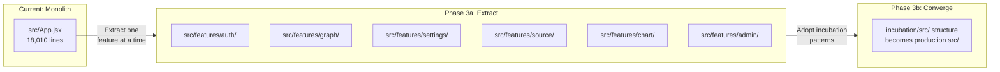
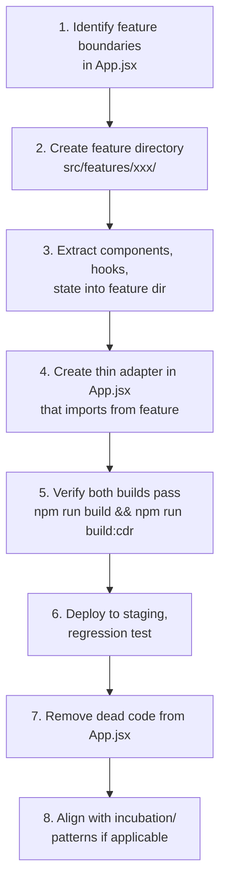

# Linkx Frontend — Multi-Domain Architecture & Incubation Convergence Strategy

**Document Version:** 1.0  
**Date:** 2026-10-21  
**Scope:** Strategic roadmap for scaling the Linkx frontend across multiple regulatory domains and converging the production monolith with the modular `incubation/` architecture.

---

## Table of Contents

1. [Current State Assessment](#1-current-state-assessment)
2. [Problem Statement](#2-problem-statement)
3. [Phase 1 — Unified Domain Registry](#3-phase-1--unified-domain-registry)
4. [Phase 2 — Zero-Config Deployment Automation](#4-phase-2--zero-config-deployment-automation)
5. [Phase 3 — Strangler Fig Migration to Incubation](#5-phase-3--strangler-fig-migration-to-incubation)
6. [Domain Onboarding Playbook](#6-domain-onboarding-playbook)
7. [Risk Matrix & Mitigations](#7-risk-matrix--mitigations)
8. [Decision Log](#8-decision-log)

---

## 1. Current State Assessment

### 1.1 Production Codebase

| Metric | Value |
|--------|-------|
| Entry point | `src/App.jsx` |
| Lines of code | **~18,010** |
| Architecture | Single-file monolith (auth, graph, settings, service accounts, admin panels — all in one file) |
| Theme system | Build-time `VITE_THEME` → `src/themes/index.js` → resolves `nbe.js` or `cdr.js` → sets `data-brand` attribute on `<html>` → CSS `[data-brand]` overrides |
| Build output | `vite.config.js` maps theme IDs to output directories (`nbe` → `linkxDS2026/`, `cdr` → `linkxCDR2026/`) |
| Domain config | `AVAILABLE_DOMAINS` array (line 3880) and `DOMAIN_SCHEMA_TEMPLATES` object (line 3925) — hardcoded inside `App.jsx` |
| Deployment | Git pull → `npm run build` / `npm run build:cdr` → Nginx serves static files |

### 1.2 Incubation Codebase (`incubation/`)

The `incubation/` directory is a **modular rewrite** of the monolith with clean separation of concerns:

```
incubation/src/
├── app/              # App composition, providers, top-level routing
│   ├── App.jsx
│   └── config.js     # Centralized env config (apiUrl, SSO origins)
├── features/         # Domain feature modules
│   ├── chart/        # Chart windows & visualizations
│   ├── configuration/# Config loading/saving, audit logs
│   ├── graph/        # Graph windows, iframe messaging, relationships
│   ├── settings/     # Profile, admin, user/service account management
│   └── source/       # Source windows, batch/realtime, data streaming
├── services/         # Backend API clients (strict payload builders)
│   ├── apiClient.js
│   ├── authApi.js
│   ├── sessionApi.js
│   ├── graphApi.js
│   ├── configurationApi.js
│   └── sourceApi.js
├── workspace/        # Desktop-like shell, window manager, focus/z-index
│   ├── components/   # WorkspaceFrame, WindowManager, WindowDock, etc.
│   ├── hooks/        # useWorkspace
│   └── state/        # workspaceReducer, workspaceContext
├── shared/           # Reusable UI components, hooks, layout helpers
│   ├── theme/        # ThemeContext, VisualElementPicker, themeCategories
│   ├── notifications/# NotificationContext, useNotifications
│   ├── hooks/
│   ├── components/
│   └── layout/
├── utils/            # inputSecurity, backgroundAnimations
├── styles/           # Theme tokens, base styles
├── main.jsx
└── main.css
```

**Incubation status:** Phase 1 — authenticated workspace shell only. No full feature parity with the monolith yet. Features are stubbed (`*WindowBody.jsx` components exist but contain placeholder content).

### 1.3 Active Deployment Targets

| Server | IP | Subnet | Theme | Output Dir | API Target (`VITE_API_URL`) | Backend |
|--------|----|--------|-------|------------|----------------------------|---------|
| NBE Host | `172.27.23.21` | Primary | `nbe` | `linkxDS2026/` | `https://172.27.23.21` | Local |
| CDR Host (local) | `172.27.23.21` | Primary | `cdr` | `linkxCDR2026/` | `https://172.27.23.21` | Local |
| CDR Host (remote) | `172.21.13.73` | Secondary | `cdr` | `linkxCDR2026/` | `https://172.21.13.73` | `172.21.13.70:8000` |

### 1.4 Current Domain Registry (inside `App.jsx`)

| Domain Key | Label | Schema Focus | Status |
|------------|-------|-------------|--------|
| `bank` | Bank / BDR | `ACCOUNTNO`, `BENACCOUNTNO`, `AMOUNTINBIRR` | ✅ Active |
| `microfinance` | Microfinance | `SENDERACCOUNTID`, `RECEIVERACCOUNTID` | ✅ Active |
| `insurance` | Insurance | `POLICY_NO`, `CLAIM_ID`, `CLAIM_AMOUNT` | ✅ Active |
| `cdr` | CDR / Telecom Records | `CALLER_MSISDN`, `CALLEE_MSISDN`, `DURATION_SEC` | ✅ Active |
| `telecom` | Telecom | Subscriber-level schema | ✅ Active |
| `fintech` | Fintech | `PAYER_WALLET`, `PAYEE_WALLET` | ✅ Active |
| `enterprise` | Enterprise | `DEBTOR_ID`, `CREDITOR_ID` | ✅ Active |

---

## 2. Problem Statement

### 2.1 Scaling Pain Points

1. **Monolith bloat** — 18,000+ lines in a single file makes feature development, code review, and debugging increasingly difficult. Every domain-specific change risks regressions across unrelated features.

2. **Hardcoded domain config** — `AVAILABLE_DOMAINS` and `DOMAIN_SCHEMA_TEMPLATES` are embedded in `App.jsx`. Adding a new domain requires editing the monolith, rebuilding, and redeploying all instances — even those unrelated to the new domain.

3. **Build-time API coupling** — `VITE_API_URL` is baked into bundles. Deploying the same code to a different server requires rebuilding with a different `.env`. This has already caused production incidents (CDR deployment shipping with NBE API URL → `ERR_CERT_AUTHORITY_INVALID`).

4. **No domain-scoped build isolation** — Currently, every build includes every domain's schemas and UI code, regardless of which deployment target it's for.

5. **Theme ≠ Domain** — The current system conflates "theme" (visual branding) with "domain" (regulatory/business context). CDR is both a theme and a domain, but Insurance is a domain without a theme. This will become confusing as more domains need their own branding.

6. **Permission collisions on shared server** — `www-data` (Nginx) and `node18` (dev user) ownership conflicts on build artifacts have caused deployment failures.

### 2.2 Convergence Challenge

The incubation codebase has the right architecture but lacks feature parity. A "big bang" rewrite would be too risky for a production system. We need an incremental migration strategy.

---

## 3. Phase 1 — Unified Domain Registry

**Goal:** Extract domain configuration from `App.jsx` into a standalone registry that both the monolith and incubation can consume.

**Timeline:** Can start immediately. Low risk, high value.

### 3.1 Proposed Directory Structure

```
src/domains/
├── index.js                 # Registry API: getDomain(), listDomains(), getDomainSchema()
├── registry.js              # Master domain list with metadata
├── schemas/
│   ├── bank.js              # Schema template for bank/BDR
│   ├── microfinance.js
│   ├── insurance.js
│   ├── cdr.js
│   ├── telecom.js
│   ├── fintech.js
│   └── enterprise.js
└── README.md
```

### 3.2 Registry Design

```js
// src/domains/registry.js
export const DOMAIN_REGISTRY = [
  {
    key: "bank",
    label: "Bank / BDR",
    description: "Standard banking transaction schema",
    icon: "🏦",
    themeId: "nbe",           // Which visual theme this domain uses (if any)
    deploymentTargets: ["172.27.23.21"],  // Which servers run this domain
    schemaFile: "./schemas/bank.js",
  },
  {
    key: "cdr",
    label: "CDR / Telecom Records",
    description: "Call Detail Records for telecommunications",
    icon: "📡",
    themeId: "cdr",
    deploymentTargets: ["172.27.23.21", "172.21.13.73"],
    schemaFile: "./schemas/cdr.js",
  },
  // ... etc
];
```

```js
// src/domains/schemas/bank.js
export default {
  canonicalColumns: {
    ACCOUNTNO: "Source Account",
    BENACCOUNTNO: "Destination Account",
    AMOUNTINBIRR: "Transaction Amount (Birr)",
    TRANSACTIONDATE: "Transaction Date",
    TRANSACTIONID: "Transaction ID",
    ACCOWNERNAME: "Sender Name",
    BENFULLNAME: "Beneficiary Name",
  },
  defaultFetchColumns: [
    "ACCOUNTNO", "BENACCOUNTNO", "AMOUNTINBIRR",
    "TRANSACTIONDATE", "TRANSACTIONID",
    "ACCOWNERNAME", "BENFULLNAME",
  ],
  defaultColumnMapping: {
    ACCOUNTNO: "ACCOUNTNO",
    BENACCOUNTNO: "BENACCOUNTNO",
    AMOUNTINBIRR: "AMOUNTINBIRR",
    TRANSACTIONDATE: "TRANSACTIONDATE",
    TRANSACTIONID: "TRANSACTIONID",
    ACCOWNERNAME: "ACCOWNERNAME",
    BENFULLNAME: "BENFULLNAME",
  },
};
```

### 3.3 Migration Steps

1. Create `src/domains/` with the registry and individual schema files.
2. Refactor `App.jsx` to import from `src/domains/index.js` instead of using inline `AVAILABLE_DOMAINS` / `DOMAIN_SCHEMA_TEMPLATES`.
3. Update `DomainSelector` component to read from the registry.
4. Verify both builds still work (`npm run build && npm run build:cdr`).
5. The `incubation/` codebase can later import the same `src/domains/` registry.

### 3.4 Adding a New Domain After This Phase

After Phase 1, adding a new domain becomes:

```bash
# 1. Create schema file:
cp src/domains/schemas/bank.js src/domains/schemas/new_domain.js
# 2. Edit the schema with domain-specific columns
# 3. Add entry to src/domains/registry.js
# 4. Build & deploy — no changes to App.jsx needed
```

---

## 4. Phase 2 — Zero-Config Deployment Automation

**Goal:** Eliminate build-time IP coupling and streamline multi-server deployments.

**Timeline:** After Phase 1. Medium complexity.

### 4.1 Runtime API URL Resolution

Instead of baking `VITE_API_URL` at compile time, resolve it at runtime:

```js
// src/config/api.js
export function getApiBaseUrl() {
  // 1. Explicit env override (for dev/testing)
  if (import.meta.env.VITE_API_URL) {
    return import.meta.env.VITE_API_URL;
  }
  // 2. Default: same origin as the served page
  return window.location.origin;
}
```

**Why this works:** In production, Nginx reverse-proxies `/auth/*`, `/init`, `/rule-thresholds`, etc. to the backend. The frontend only needs to call its own origin — Nginx handles routing. This means:

- **One build** can be deployed to **any server** without rebuilding.
- The `ERR_CERT_AUTHORITY_INVALID` class of deployment bugs becomes impossible.
- `deploy_pkg_172.21.13.73/.env` is no longer needed.

### 4.2 Per-Domain Build Scripts

Add convenience scripts for future domains:

```json
{
  "scripts": {
    "build": "vite build",
    "build:nbe": "VITE_THEME=nbe vite build",
    "build:cdr": "VITE_THEME=cdr vite build",
    "build:insurance": "VITE_THEME=insurance vite build",
    "build:all": "npm run build:nbe && npm run build:cdr",
    "deploy:cdr-remote": "npm run build:cdr && rsync -avz linkxCDR2026/ user@172.21.13.73:/var/www/linkx-frontend/linkxCDR2026/"
  }
}
```

### 4.3 Deployment Ownership Fix

Create a deploy script that handles the `www-data` / `node18` ownership dance:

```bash
#!/bin/bash
# deploy.sh — Run as node18 on the target server
set -e

THEME="${1:-nbe}"
BUILD_DIR="linkxDS2026"
[ "$THEME" = "cdr" ] && BUILD_DIR="linkxCDR2026"

echo "=== Deploying $THEME ($BUILD_DIR) ==="

# Take ownership for build
sudo chown -R $(whoami):$(whoami) /var/www/linkx-frontend

# Pull latest code
cd /var/www/linkx-frontend
git fetch origin main
git reset --hard origin/main

# Install dependencies if needed
npm ci --prefer-offline 2>/dev/null || true

# Build
npm run build:$THEME

# Hand ownership back to Nginx
sudo chown -R www-data:www-data "$BUILD_DIR"

echo "=== ✅ $THEME deployed successfully ==="
```

### 4.4 vite.config.js — Future Theme Auto-Discovery

```js
// Future: auto-discover themes from src/themes/
const THEME_BUILD_PATHS = {
  nbe: "linkxDS2026",
  cdr: "linkxCDR2026",
  insurance: "linkxINS2026",    // Future
  // Auto-generated from src/domains/registry.js
};
```

---

## 5. Phase 3 — Strangler Fig Migration to Incubation

**Goal:** Incrementally replace the 18,000-line monolith with the modular `incubation/` architecture — one feature at a time — without any "big bang" rewrite risk.

**Timeline:** Ongoing, after Phases 1 and 2 provide the foundation.

### 5.1 The Strangler Fig Pattern

The [Strangler Fig pattern](https://martinfowler.com/bliki/StranglerFigApplication.html) works by:

1. **Wrapping** the old system with a new facade.
2. **Growing** new modules around the old ones.
3. **Redirecting** traffic from old code to new code, one feature at a time.
4. **Removing** dead old code when no longer referenced.



### 5.2 Feature Migration Priority Matrix

Features ranked by **extraction value** (how much it simplifies the monolith) and **extraction risk** (how tangled it is with other features):

| Priority | Feature | Lines (est.) | Value | Risk | Incubation Ready? | Notes |
|----------|---------|-------------|-------|------|-------------------|-------|
| 1 | **Domain Registry** | ~200 | 🟢 High | 🟢 Low | N/A (Phase 1) | Already planned above |
| 2 | **Service Account Management** | ~800 | 🟢 High | 🟡 Medium | Stubbed (`settings/`) | Self-contained UI + API calls |
| 3 | **Auth / Login / Session** | ~500 | 🟢 High | 🟡 Medium | ✅ (`auth/`, `services/authApi.js`) | Shared by all features |
| 4 | **Admin Panel** | ~600 | 🟡 Medium | 🟡 Medium | Stubbed (`settings/`) | User management, system config |
| 5 | **Source Window** | ~2,000 | 🟢 High | 🔴 High | Stubbed (`source/`) | Deeply coupled to graph state |
| 6 | **Graph Window** | ~4,000 | 🟢 Highest | 🔴 High | Stubbed (`graph/`) | Core feature, iframe messaging |
| 7 | **Chart Window** | ~1,500 | 🟡 Medium | 🟡 Medium | Stubbed (`chart/`) | Depends on graph data |
| 8 | **Configuration** | ~1,000 | 🟡 Medium | 🟢 Low | Stubbed (`configuration/`) | Mostly independent |
| 9 | **Idle/Session Timeout** | ~300 | 🟢 High | 🟢 Low | Not started | Clean hook, few deps |

### 5.3 Migration Workflow Per Feature



**Key rule:** At every step, `App.jsx` must remain the single entry point. Features are extracted *out of* the monolith but imported *back into* it through clean interfaces.

### 5.4 Shared State Bridge

The biggest challenge is shared state. Currently, `App.jsx` uses a massive `useState`/`useRef` tree. The migration plan:

1. **Extract state slices** — Each feature gets its own context/reducer (like `incubation/src/workspace/state/`).
2. **Bridge via props** — During migration, `App.jsx` passes state down to extracted feature components via props.
3. **Migrate to context** — Once a feature is fully extracted, replace prop drilling with context providers (matching incubation patterns).
4. **Final consolidation** — When all features are extracted, `App.jsx` becomes a thin shell (~200 lines) that composes providers and routes.

### 5.5 Convergence with Incubation

The incubation codebase defines the **target architecture**. As features are extracted from the monolith:

1. **Adopt incubation's directory structure** — `src/features/`, `src/services/`, `src/shared/`, `src/workspace/`.
2. **Adopt incubation's API client pattern** — `services/apiClient.js` with strict payload builders instead of inline `fetch()` calls.
3. **Adopt incubation's context patterns** — `ThemeContext`, `NotificationContext`, `WorkspaceContext`.
4. **Port incubation code** — Where incubation already has working implementations (e.g., `WorkspaceFrame`, `WindowManager`), port them into the production tree.
5. **Retire `incubation/`** — Once production `src/` fully mirrors incubation's structure with full feature parity, the `incubation/` directory becomes obsolete.

> **⚠️ Constraint:** Never modify files inside `incubation/` during this process. It remains a read-only reference architecture.

---

## 6. Domain Onboarding Playbook

When a new regulatory domain needs to be added (e.g., "Capital Markets", "Customs", "Tax Authority"):

### 6.1 Checklist

```
□ 1. Create schema file: src/domains/schemas/<domain_key>.js
      - Define canonicalColumns, defaultFetchColumns, defaultColumnMapping
      
□ 2. Register domain: Add entry to src/domains/registry.js
      - key, label, description, icon, themeId, deploymentTargets

□ 3. Theme (if needed):
      □ a. Create src/themes/<domain_key>.js with brand colors/assets
      □ b. Add CSS overrides: [data-brand="<domain_key>"] { ... }
      □ c. Register in src/themes/index.js
      □ d. Add build path to vite.config.js THEME_BUILD_PATHS
      □ e. Add build script to package.json

□ 4. If domain does NOT need its own theme:
      - Set themeId to an existing theme (e.g., "nbe") in registry

□ 5. Backend:
      □ a. Elasticsearch index/mapping for domain data
      □ b. API endpoints registered for domain routing
      □ c. Service account template for domain

□ 6. Build & verify:
      npm run build && npm run build:cdr  (and any new theme builds)
      
□ 7. Deploy to target server(s)

□ 8. Update this strategy doc's domain table
```

### 6.2 Theme vs. Domain — Decision Framework

```
Does the domain need its own visual branding (colors, logo, login page)?
├── YES → Create a new theme + build target
│         Examples: NBE/BDR (gold), CDR (sky-blue)
│         Result: New output dir (e.g., linkxINS2026/)
│
└── NO  → Reuse an existing theme
          Examples: Insurance uses NBE theme, Microfinance uses NBE theme
          Result: No new build target needed
```

---

## 7. Risk Matrix & Mitigations

| Risk | Impact | Likelihood | Mitigation |
|------|--------|------------|------------|
| Feature extraction breaks shared state | 🔴 High | 🟡 Medium | Extract one feature at a time. Keep integration tests. Never extract without a working rollback commit. |
| Build size increases from domain registry | 🟢 Low | 🟢 Low | Tree-shaking eliminates unused schemas. Each schema file is <1KB. |
| Runtime API URL breaks in non-Nginx environments | 🟡 Medium | 🟢 Low | Keep `VITE_API_URL` env override as escape hatch. |
| Incubation patterns don't fit production needs | 🟡 Medium | 🟡 Medium | Incubation is a reference, not a mandate. Adapt patterns as needed. |
| Git conflicts on multi-server deployment | 🟡 Medium | 🟡 Medium | Use `deploy.sh` script with `git fetch + reset --hard`. Never modify tracked build artifacts on production servers. |
| Permission errors on shared servers | 🟡 Medium | 🟢 Low (after fix) | `deploy.sh` handles `chown` dance. Add `linkxCDR2026/` and `linkxDS2026/` to `.gitignore` to prevent tracking build artifacts. |

---

## 8. Decision Log

| Date | Decision | Rationale | Status |
|------|----------|-----------|--------|
| 2026-10-21 | Strategy: Strangler Fig, not Big Bang rewrite | Monolith is in production, serves multiple institutions. Can't afford downtime. | ✅ Approved |
| 2026-10-21 | Phase 1 first: Domain Registry extraction | Highest value, lowest risk. Unblocks both multi-domain scaling and incubation convergence. | 🔜 Next |
| 2026-10-21 | Runtime API URL resolution | Eliminates build-per-server requirement and deployment bugs. | 🔜 Planned |
| 2026-10-21 | Never modify `incubation/` | It's a reference architecture. Production evolves toward it, not the other way around. | ✅ Standing rule |
| 2026-10-21 | Theme ≠ Domain | Domains can share themes. Not every domain needs a separate build target. | ✅ Approved |

---

## Appendix A — Current Build & Deploy Commands

```bash
# Development
npm run dev          # Start dev server (NBE theme)
npm run dev:cdr      # Start dev server (CDR theme)

# Production builds (on build server)
npm run build        # Build NBE/BDR → linkxDS2026/
npm run build:cdr    # Build CDR → linkxCDR2026/

# Deploy to remote CDR server (172.21.13.73)
# Run ON the remote server:
sudo chown -R node18:node18 /var/www/linkx-frontend
cd /var/www/linkx-frontend
git fetch origin main
git reset --hard origin/main
npm run build:cdr
sudo chown -R www-data:www-data linkxCDR2026
```

## Appendix B — Key File Locations

| File | Purpose |
|------|---------|
| `src/App.jsx` | Production monolith (18,010 lines) |
| `src/themes/index.js` | Theme resolver |
| `src/themes/nbe.js` | NBE/BDR theme tokens |
| `src/themes/cdr.js` | CDR theme tokens |
| `vite.config.js` | Build configuration, theme→output mapping |
| `package.json` | Build scripts |
| `incubation/src/` | Reference modular architecture |
| `docs/handoff_multi_theme_system.md` | Theme system handoff |
| `docs/handoff_service_accounts_and_multi_domain.md` | Service accounts & deployment handoff |

---

*This is a living document. Update it as phases are completed and new domains are onboarded.*
