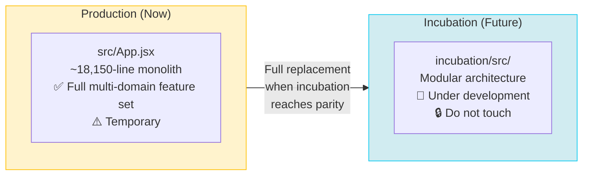
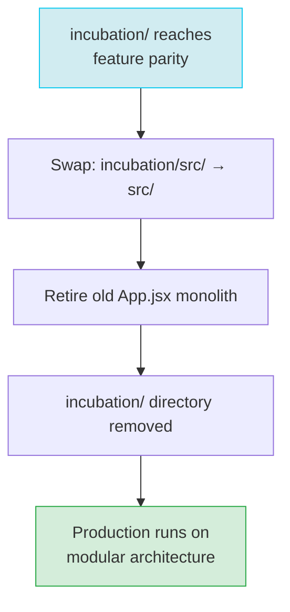

# Linkx Frontend — Multi-Domain Architecture & Future Transition Strategy

**Document Version:** 2.1  
**Date:** 2026-10-21  
**Scope:** How to manage the Linkx frontend going forward — supporting multiple domains on the current production codebase while preparing for a full transition to the `incubation/` architecture.

---

## Table of Contents

1. [Ground Rules](#1-ground-rules)
2. [Current State](#2-current-state)
3. [The Two Codebases](#3-the-two-codebases)
4. [Multi-Domain Management (Now)](#4-multi-domain-management-now)
5. [Deployment Workflow & Automation](#5-deployment-workflow--automation)
6. [The Transition (Future)](#6-the-transition-future)
7. [Domain Onboarding Playbook](#7-domain-onboarding-playbook)
8. [Risk Matrix](#8-risk-matrix)
9. [Decision Log](#9-decision-log)

---

## 1. Ground Rules

> **These are non-negotiable. Every contributor must follow them.**

| # | Rule | Rationale |
|---|------|-----------|
| 1 | **Never touch anything inside `incubation/`** | It is a separate project being developed independently. It will replace the current codebase when ready. No one working on the production monolith should modify, refactor, or "help" the incubation code. |
| 2 | **The current monolith (`src/App.jsx`) is temporary** | It works, it's in production, we maintain it — but we know it will be fully replaced by `incubation/` in the future. Don't invest in heavy architectural refactoring of it. |
| 3 | **Keep changes to the monolith minimal and surgical** | When adding a new domain, feature, or fix — do the minimum needed. No over-engineering on throwaway code. |
| 4 | **Always build both themes after changes** | `npm run build && npm run build:cdr` — verify both work. |
| 5 | **Always verify `git status incubation/` is clean** | If you see changes in `incubation/`, you broke Rule 1. |

---

## 2. Current State

### 2.1 Production Codebase

| Metric | Value |
|--------|-------|
| Entry point | `src/App.jsx` |
| Lines of code | **~18,150** |
| Architecture | Single-file monolith (auth, graph, settings, service accounts, admin, detection thresholds — all in one file) |
| Profile & Theme system | Build-time `VITE_THEME` (`nbe` vs `cdr`) ➔ resolves theme tokens, sets `data-brand` attribute, toggles domain UI profiles |
| Build output | `vite.config.js` maps `nbe` → `linkxDS2026/`, `cdr` → `linkxCDR2026/` |
| Domain config | `AVAILABLE_DOMAINS` and `DOMAIN_SCHEMA_TEMPLATES` inside `App.jsx` |
| Deployment | Automated via [`deploy.sh`](file:///var/www/linkx-frontend/deploy.sh) + smart runtime host guard (`resolveApiUrl`) |

### 2.2 Active Domains

| Domain Key | Label | Profile / Focus | Status |
|------------|-------|-----------------|--------|
| `bank` | Bank / BDR | Core banking schema (`ACCOUNTNO`, `BENACCOUNTNO`, `AMOUNTINBIRR`), AML thresholds (CTR, Smurfing) | ✅ Active |
| `microfinance` | Microfinance | Community finance & micro-loans (`SENDERACCOUNTID`, `RECEIVERACCOUNTID`) | ✅ Active |
| `insurance` | Insurance | Policy & claims payouts (`POLICY_NO`, `CLAIM_ID`, `CLAIM_AMOUNT`) | ✅ Active |
| `cdr` | CDR / Telecom Records | Telecom intelligence (`CALLER_MSISDN`, `CALLEE_MSISDN`, `DURATION_SEC`), 18 telecom thresholds, 17 fraud typologies, duration volume tiers | ✅ Active |
| `telecom` | Telecom | Subscriber-level schema | ✅ Active |
| `fintech` | Fintech | E-wallets & payment gateways (`PAYER_WALLET`, `PAYEE_WALLET`) | ✅ Active |
| `enterprise` | Enterprise | Corporate ERP & ledger (`DEBTOR_ID`, `CREDITOR_ID`) | ✅ Active |

### 2.3 Active Deployment Targets

| Server | IP | Theme | Output Dir | API Target (`VITE_API_URL`) | Backend |
|--------|----|-------|------------|----------------------------|---------|
| NBE Host | `172.27.23.21` | `nbe` | `linkxDS2026/` | `https://172.27.23.21` (or same-origin) | Local |
| CDR Host (local) | `172.27.23.21` | `cdr` | `linkxCDR2026/` | `https://172.27.23.21` (or same-origin) | Local |
| CDR Host (remote) | `172.21.13.73` | `cdr` | `linkxCDR2026/` | `https://172.21.13.73` (auto-detected) | `172.21.13.70:8000` |

---

## 3. The Two Codebases



### What this means in practice:

- **Need to add a domain?** → Add the domain schema in `AVAILABLE_DOMAINS` and `DOMAIN_SCHEMA_TEMPLATES` in `App.jsx`.
- **Need domain-specific UI (like CDR Telecom)?** → Drive it from `theme.id` or domain profile (`isCdrDomain`). Single codebase, interchangeable builds.
- **Need a new theme?** → Add a theme file in `src/themes/`, register it in `index.js`, add build path to `vite.config.js`.
- **Want to refactor the monolith into modules?** → **Don't.** The incubation codebase is already doing that. Wait for the transition.

---

## 4. Multi-Domain Management (Now)

### 4.1 How Domains Work Today

1. **`AVAILABLE_DOMAINS` array** — list of domain objects with `key`, `label`, `icon`, `description`.
2. **`DOMAIN_SCHEMA_TEMPLATES` object** — maps each domain key to its Elasticsearch column schema (`fetch_columns`, `column_mapping`).
3. **`DomainSelector` component** — renders responsive radio pill cards.
4. **Domain Profile Switcher (`isCdrDomain`)**:
   - Switches terminology: MSISDN, Destination, Call Duration, Call Start Time, Cell Tower ID.
   - Activates domain-specific detection screens (e.g. 18 telecom parameters vs 24 banking AML rules).
   - Activates domain risk scoring (e.g. 17 telecom typologies & duration tiers vs AML typologies).

### 4.2 Adding a New Domain

To add a new domain (e.g., "Capital Markets"):

**Step 1:** Add to `AVAILABLE_DOMAINS` array:
```js
{ key: "capital_markets", label: "Capital Markets", icon: "📈", description: "Securities and stock exchange transactions" },
```

**Step 2:** Add to `DOMAIN_SCHEMA_TEMPLATES` object:
```js
capital_markets: {
  fetch_columns: ["SECURITY_ID", "BUYER_ACCOUNT", "SELLER_ACCOUNT", "TRADE_AMOUNT", "TRADE_DATE", "SETTLEMENT_DATE"],
  column_mapping: {
    SECURITY_ID: "TRANSACTIONID",
    BUYER_ACCOUNT: "ACCOUNTNO",
    SELLER_ACCOUNT: "BENACCOUNTNO",
    TRADE_AMOUNT: "AMOUNTINBIRR",
    TRADE_DATE: "TRANSACTIONDATE",
  },
},
```

**Step 3:** Build & verify:
```bash
npm run build && npm run build:cdr
```

---

## 5. Deployment Workflow & Automation

### 5.1 Automated Deploy Script (`deploy.sh`)

Deploying to any server is now automated with [`deploy.sh`](file:///var/www/linkx-frontend/deploy.sh):

```bash
cd /var/www/linkx-frontend
./deploy.sh cdr          # Pull & build CDR theme
./deploy.sh nbe          # Pull & build NBE theme
./deploy.sh all          # Pull & build all themes
```

What `deploy.sh` handles automatically:
1. Takes file ownership for the dev user (`sudo chown -R $USER:$USER`).
2. Syncs cleanly with Git (`git fetch origin main && git reset --hard origin/main`).
3. Auto-detects `172.21.13.73` host and applies `deploy_pkg_172.21.13.73/.env` automatically.
4. Compiles the requested build target.
5. Hands output directories back to Nginx (`sudo chown -R www-data:www-data`).

### 5.2 Smart Host Guard (`resolveApiUrl`)

To prevent CORS and SSL errors when deploying across multi-server environments:
* The client checks whether the current page host differs from the statically baked build URL.
* If loaded on `https://172.21.13.73`, but built with `https://172.27.23.21`, it **automatically resolves to `window.location.origin` (`https://172.21.13.73`)**.
* Eliminates cross-origin failure modes without requiring manual `.env` edits.

---

## 6. The Transition (Future)

### 6.1 What Will Happen

When the `incubation/` codebase reaches feature parity with the monolith, it will **fully replace** the current `src/` directory.



### 6.2 What Carries Over

| What | Where it lives now | Notes |
|------|--------------------|-------|
| Domain definitions | `AVAILABLE_DOMAINS` + `DOMAIN_SCHEMA_TEMPLATES` in `App.jsx` | Port into `incubation/src/domains/` |
| Theme files | `src/themes/nbe.js`, `src/themes/cdr.js` | Port to `src/shared/theme/` |
| CDR Detection Thresholds | `RuleThresholdsPanel` (18 telecom parameters) | Port to `src/features/configuration/` |
| CDR Risk Scoring & Typologies | `ScoreLineagePanel` (17 typologies + duration tiers) | Port to `src/features/configuration/` |
| Service account management | Inline in `App.jsx` | Port to `src/features/settings/` |
| System principal protection | Inline in `App.jsx` | Port to `src/features/settings/` |
| Idle timeout hook | `useIdleTimeout` in `App.jsx` | Port to `src/shared/hooks/` |
| Build config & deploy scripts | `vite.config.js`, `package.json`, `deploy.sh` | Carry over as-is |

---

## 7. Domain Onboarding Playbook

```
□ 1. Add entry to AVAILABLE_DOMAINS array in src/App.jsx (~line 3880)
     → { key, label, icon, description }

□ 2. Add entry to DOMAIN_SCHEMA_TEMPLATES in src/App.jsx (~line 3925)
     → { fetch_columns: [...], column_mapping: {...} }

□ 3. Does this domain need its own branded theme?
     □ YES:
       □ a. Create src/themes/<id>.js
       □ b. Register in src/themes/index.js
       □ c. Add CSS [data-brand="<id>"] overrides
       □ d. Add build path to vite.config.js
       □ e. Add build script to package.json
       □ f. Configure Nginx location block
     □ NO:
       → Done. It uses the default theme.

□ 4. Build & verify:
     npm run build && npm run build:cdr

□ 5. Deploy to target server(s) using ./deploy.sh
```

---

## 8. Risk Matrix

| Risk | Impact | Mitigation | Status |
|------|--------|------------|--------|
| Wrong `.env` baked into build | 🔴 High | `resolveApiUrl` runtime guard + `deploy.sh` auto-detection | ✅ Mitigated |
| Permission errors on remote servers | 🟡 Medium | `deploy.sh` handles `chown` dance before/after build | ✅ Mitigated |
| Accidental edits to `incubation/` | 🔴 High | Strict rule: `git status incubation/` checked before commits | ✅ Enforced |
| Incubation transition loses production features | 🔴 High | "What Carries Over" checklist maintained in Section 6.2 | 🔜 Planned |

---

## 9. Decision Log

| Date | Decision | Rationale | Status |
|------|----------|-----------|--------|
| 2026-10-21 | **Full replacement, not incremental migration** | Clean separation of concerns; incubation matures independently. | ✅ Approved |
| 2026-10-21 | **Never touch `incubation/`** | Production work should never interfere with incubation code. | ✅ Standing rule |
| 2026-10-21 | **Interchangeable Build Profile for CDR** | Keeps both domains unified in one codebase without diverging forks. | ✅ Delivered |
| 2026-10-21 | **Runtime host mismatch guard** | Eliminates cross-origin CORS errors automatically. | ✅ Delivered |
| 2026-10-21 | **Automated `deploy.sh` script** | Simplifies remote server updates to a single command. | ✅ Delivered |

---

## Appendix — Quick Commands

```bash
# Development
npm run dev              # Dev server (NBE theme)
npm run dev:cdr          # Dev server (CDR theme)

# Production builds (local)
npm run build            # NBE/BDR → linkxDS2026/
npm run build:cdr        # CDR → linkxCDR2026/
npm run build:all        # Both in one step

# Remote server deployment (172.21.13.73)
./deploy.sh cdr
```
