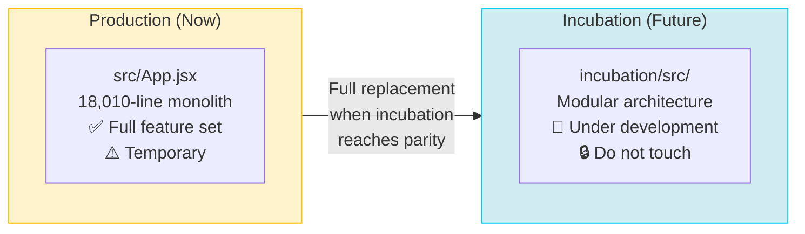
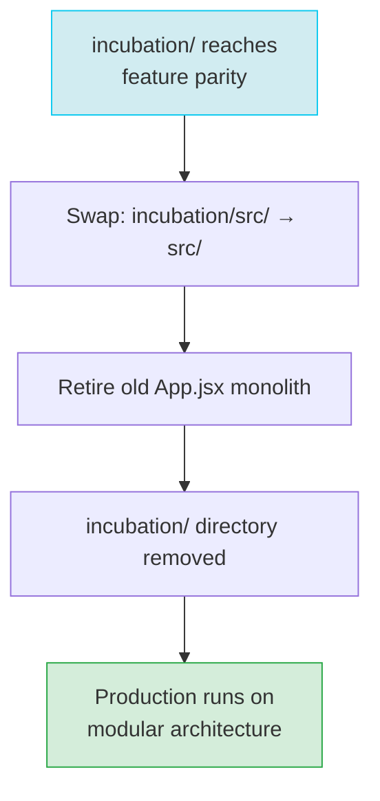

# Linkx Frontend — Multi-Domain Architecture & Future Transition Strategy

**Document Version:** 2.0  
**Date:** 2026-10-21  
**Scope:** How to manage the Linkx frontend going forward — supporting multiple domains on the current production codebase while preparing for a full transition to the `incubation/` architecture.

---

## Table of Contents

1. [Ground Rules](#1-ground-rules)
2. [Current State](#2-current-state)
3. [The Two Codebases](#3-the-two-codebases)
4. [Multi-Domain Management (Now)](#4-multi-domain-management-now)
5. [Deployment Workflow](#5-deployment-workflow)
6. [The Transition (Future)](#6-the-transition-future)
7. [Domain Onboarding Playbook](#7-domain-onboarding-playbook)
8. [Risk Matrix](#8-risk-matrix)
9. [Decision Log](#9-decision-log)

---

## 1. Ground Rules

> **These are non-negotiable. Every contributor must follow them.**

| # | Rule | Rationale |
|---|------|-----------|
| 1 | **Never touch anything inside `incubation/`** | It is a separate project being developed independently. It will replace the current codebase when ready. No one working on the production monolith should modify, refactor, or "help" the incubation code. |
| 2 | **The current monolith (`src/App.jsx`) is temporary** | It works, it's in production, we maintain it — but we know it will be fully replaced by `incubation/` in the future. Don't invest in heavy architectural refactoring of it. |
| 3 | **Keep changes to the monolith minimal and surgical** | When adding a new domain, feature, or fix — do the minimum needed. No over-engineering on throwaway code. |
| 4 | **Always build both themes after changes** | `npm run build && npm run build:cdr` — verify both work. |
| 5 | **Always verify `git status incubation/` is clean** | If you see changes in `incubation/`, you broke Rule 1. |

---

## 2. Current State

### 2.1 Production Codebase

| Metric | Value |
|--------|-------|
| Entry point | `src/App.jsx` |
| Lines of code | **~18,010** |
| Architecture | Single-file monolith (auth, graph, settings, service accounts, admin — all in one file) |
| Theme system | Build-time `VITE_THEME` → `src/themes/index.js` → resolves `nbe.js` or `cdr.js` → `data-brand` on `<html>` → CSS overrides |
| Build output | `vite.config.js` maps `nbe` → `linkxDS2026/`, `cdr` → `linkxCDR2026/` |
| Domain config | `AVAILABLE_DOMAINS` (line ~3880) and `DOMAIN_SCHEMA_TEMPLATES` (line ~3925) inside `App.jsx` |

### 2.2 Active Domains

| Domain Key | Label | Schema Focus | Status |
|------------|-------|-------------|--------|
| `bank` | Bank / BDR | `ACCOUNTNO`, `BENACCOUNTNO`, `AMOUNTINBIRR` | ✅ Active |
| `microfinance` | Microfinance | `SENDERACCOUNTID`, `RECEIVERACCOUNTID` | ✅ Active |
| `insurance` | Insurance | `POLICY_NO`, `CLAIM_ID`, `CLAIM_AMOUNT` | ✅ Active |
| `cdr` | CDR / Telecom Records | `CALLER_MSISDN`, `CALLEE_MSISDN`, `DURATION_SEC` | ✅ Active |
| `telecom` | Telecom | Subscriber-level schema | ✅ Active |
| `fintech` | Fintech | `PAYER_WALLET`, `PAYEE_WALLET` | ✅ Active |
| `enterprise` | Enterprise | `DEBTOR_ID`, `CREDITOR_ID` | ✅ Active |

### 2.3 Active Deployment Targets

| Server | IP | Theme | Output Dir | API Target (`VITE_API_URL`) | Backend |
|--------|----|-------|------------|----------------------------|---------|
| NBE Host | `172.27.23.21` | `nbe` | `linkxDS2026/` | `https://172.27.23.21` | Local |
| CDR Host (local) | `172.27.23.21` | `cdr` | `linkxCDR2026/` | `https://172.27.23.21` | Local |
| CDR Host (remote) | `172.21.13.73` | `cdr` | `linkxCDR2026/` | `https://172.21.13.73` | `172.21.13.70:8000` |

---

## 3. The Two Codebases



### What this means in practice:

- **Need to add a domain?** → Edit `App.jsx` directly. Add the entry to `AVAILABLE_DOMAINS` and `DOMAIN_SCHEMA_TEMPLATES`. Minimal, surgical change.
- **Need a new theme?** → Add a theme file in `src/themes/`, register it in `index.js`, add build path to `vite.config.js`. Done.
- **Need to fix a bug?** → Fix it in `src/App.jsx`. Don't restructure surrounding code.
- **Want to refactor the monolith into modules?** → **Don't.** The incubation codebase is already doing that. Wait for the transition.

---

## 4. Multi-Domain Management (Now)

### 4.1 How Domains Work Today

Everything lives in `src/App.jsx`:

1. **`AVAILABLE_DOMAINS` array** (~line 3880) — list of domain objects with `key`, `label`, `icon`, `description`.
2. **`DOMAIN_SCHEMA_TEMPLATES` object** (~line 3925) — maps each domain key to its Elasticsearch column schema (`fetch_columns`, `column_mapping`).
3. **`DomainSelector` component** (~line 4125) — renders radio pill cards from `AVAILABLE_DOMAINS`.

### 4.2 Adding a New Domain

To add a new domain (e.g., "Capital Markets"):

**Step 1:** Add to `AVAILABLE_DOMAINS` array (~line 3880):
```js
{ key: "capital_markets", label: "Capital Markets", icon: "📈", description: "Securities and stock exchange transactions" },
```

**Step 2:** Add to `DOMAIN_SCHEMA_TEMPLATES` object (~line 3925):
```js
capital_markets: {
  fetch_columns: ["SECURITY_ID", "BUYER_ACCOUNT", "SELLER_ACCOUNT", "TRADE_AMOUNT", "TRADE_DATE", "SETTLEMENT_DATE"],
  column_mapping: {
    SECURITY_ID: "TRANSACTIONID",
    BUYER_ACCOUNT: "ACCOUNTNO",
    SELLER_ACCOUNT: "BENACCOUNTNO",
    TRADE_AMOUNT: "AMOUNTINBIRR",
    TRADE_DATE: "TRANSACTIONDATE",
  },
},
```

**Step 3:** Build & deploy:
```bash
npm run build && npm run build:cdr
```

That's it. No structural changes, no new files, no refactoring.

### 4.3 Theme vs. Domain

Not every domain needs its own theme. Themes are about **visual branding** (colors, logos, login page). Domains are about **data schemas** (column mappings, Elasticsearch structure).

```
Does this domain's client/institution need its own branded look?
│
├── YES → Create a new theme (see Section 4.4)
│         Current examples: NBE/BDR (gold theme), CDR (sky-blue theme)
│
└── NO  → Just add the domain to AVAILABLE_DOMAINS + DOMAIN_SCHEMA_TEMPLATES
          Current examples: Insurance, Microfinance, Fintech, Telecom, Enterprise
          (all use the default NBE theme)
```

### 4.4 Adding a New Theme (When a Domain Needs Its Own Branding)

When a domain's institution requires its own visual identity:

**Step 1:** Create theme file `src/themes/<theme_id>.js`:
```js
export default {
  id: "insurance",
  name: "Linkx Insurance",
  brand: "insurance",
  // ... brand colors, logo references, etc.
};
```

**Step 2:** Register in `src/themes/index.js`:
```js
import insurance from "./insurance.js";
const themes = { nbe, cdr, insurance };
```

**Step 3:** Add CSS overrides in stylesheets:
```css
[data-brand="insurance"] .login_bg { background: ...; }
```

**Step 4:** Add build path to `vite.config.js`:
```js
const THEME_BUILD_PATHS = {
  nbe: "linkxDS2026",
  cdr: "linkxCDR2026",
  insurance: "linkxINS2026",  // New
};
```

**Step 5:** Add build script to `package.json`:
```json
"build:insurance": "rm -f linkxINS2026/assets/index-*.js linkxINS2026/assets/index-*.css && VITE_THEME=insurance vite build"
```

**Step 6:** Configure Nginx to serve `/linkxINS2026/`.

---

## 5. Deployment Workflow

### 5.1 Local Server (`172.27.23.21`)

```bash
cd /var/www/linkx-frontend
npm run build        # NBE/BDR → linkxDS2026/
npm run build:cdr    # CDR → linkxCDR2026/
```

### 5.2 Remote CDR Server (`172.21.13.73`)

Run these commands **on the remote server**:

```bash
cd /var/www/linkx-frontend

# 1. Take ownership for git/npm operations:
sudo chown -R node18:node18 /var/www/linkx-frontend

# 2. Pull latest code:
git fetch origin main
git reset --hard origin/main

# 3. Set correct .env for this server:
cp deploy_pkg_172.21.13.73/.env .env

# 4. Build CDR theme:
npm run build:cdr

# 5. Hand ownership back to Nginx:
sudo chown -R www-data:www-data linkxCDR2026
```

### 5.3 Known Deployment Gotchas

| Issue | Cause | Fix |
|-------|-------|-----|
| `Permission denied` on git pull/build | `linkxCDR2026/` owned by `www-data` | `sudo chown -R node18:node18 /var/www/linkx-frontend` before git/npm |
| `ERR_CERT_AUTHORITY_INVALID` in browser | Built with wrong `.env` (wrong `VITE_API_URL`) | `cp deploy_pkg_172.21.13.73/.env .env` before building |
| Git `unable to unlink` errors | Same ownership issue | Same fix as above |
| Old version still showing after deploy | Browser cache or Nginx cache | Hard refresh (`Ctrl+Shift+R`) or restart Nginx |

---

## 6. The Transition (Future)

### 6.1 What Will Happen

When the `incubation/` codebase reaches feature parity with the monolith, it will **fully replace** the current `src/` directory. This is not an incremental migration — it's a complete swap.



### 6.2 Incubation Architecture (Target State)

```
src/                          (after transition)
├── app/                      # App composition, providers, routing
├── features/                 # Feature modules
│   ├── chart/                # Chart windows & visualizations
│   ├── configuration/        # Config loading/saving, audit logs
│   ├── graph/                # Graph windows, iframe messaging
│   ├── settings/             # Profile, admin, user/service accounts
│   └── source/               # Source windows, batch/realtime, streaming
├── services/                 # Backend API clients
│   ├── apiClient.js
│   ├── authApi.js
│   ├── sessionApi.js
│   ├── graphApi.js
│   ├── configurationApi.js
│   └── sourceApi.js
├── workspace/                # Desktop-like shell, window manager
│   ├── components/
│   ├── hooks/
│   └── state/
├── shared/                   # Reusable UI, hooks, layout, theme
│   ├── theme/
│   ├── notifications/
│   ├── hooks/
│   ├── components/
│   └── layout/
├── auth/                     # Authentication
├── utils/                    # Utilities
├── styles/                   # Theme tokens, base styles
└── main.jsx
```

### 6.3 What Carries Over

When the transition happens, these production artifacts will need to be ported into the incubation structure:

| What | Where it lives now | Notes |
|------|--------------------|-------|
| Domain definitions | `AVAILABLE_DOMAINS` + `DOMAIN_SCHEMA_TEMPLATES` in `App.jsx` | Copy into appropriate feature module |
| Theme files | `src/themes/nbe.js`, `src/themes/cdr.js` | Port to `src/shared/theme/` |
| Service account UI | Inline in `App.jsx` (~800 lines) | Port to `src/features/settings/` |
| System principal protection | Inline in `App.jsx` | Port to `src/features/settings/` |
| Idle timeout hook | `useIdleTimeout` in `App.jsx` | Port to `src/shared/hooks/` |
| Build config | `vite.config.js`, `package.json` scripts | Carry over as-is |
| Deployment scripts | `deploy_pkg_172.21.13.73/` | Carry over as-is |

### 6.4 What We Do NOT Do

- ❌ **Do NOT refactor the monolith into modules** — the incubation codebase already has the modular structure. Refactoring the monolith is wasted effort.
- ❌ **Do NOT extract features from `App.jsx` into `src/features/`** — that's what incubation is for.
- ❌ **Do NOT try to make the monolith and incubation share code** — they are separate codebases with separate lifecycles.
- ❌ **Do NOT modify anything inside `incubation/`** from production work.

---

## 7. Domain Onboarding Playbook

### Quick checklist for adding a new domain to the current production system:

```
□ 1. Add entry to AVAILABLE_DOMAINS array in src/App.jsx (~line 3880)
     → { key, label, icon, description }

□ 2. Add entry to DOMAIN_SCHEMA_TEMPLATES in src/App.jsx (~line 3925)
     → { fetch_columns: [...], column_mapping: {...} }

□ 3. Does this domain need its own branded theme?
     □ YES:
       □ a. Create src/themes/<id>.js
       □ b. Register in src/themes/index.js
       □ c. Add CSS [data-brand="<id>"] overrides
       □ d. Add build path to vite.config.js
       □ e. Add build script to package.json
       □ f. Configure Nginx location block
     □ NO:
       → Done. It uses the default theme.

□ 4. Backend setup:
     □ a. Elasticsearch index/mapping
     □ b. API endpoints
     □ c. Service account template

□ 5. Build & verify:
     npm run build && npm run build:cdr  (+ any new theme builds)

□ 6. Deploy to target server(s)

□ 7. Update domain table in this doc (Section 2.2)
```

---

## 8. Risk Matrix

| Risk | Impact | Mitigation |
|------|--------|------------|
| Monolith grows even larger as domains are added | 🟡 Medium | Each domain adds ~20 lines. Manageable until the transition. |
| Wrong `.env` baked into build | 🔴 High | Always verify `VITE_API_URL` matches target server before building. |
| Permission errors on remote servers | 🟡 Medium | Follow the `chown` dance in Section 5.2. |
| Incubation transition loses production features | 🔴 High | Maintain the "What Carries Over" checklist (Section 6.3). Test extensively before swapping. |
| Browser serves stale cached bundles after deploy | 🟢 Low | Vite generates content-hashed filenames. Hard refresh if needed. |

---

## 9. Decision Log

| Date | Decision | Rationale |
|------|----------|-----------|
| 2026-10-21 | **Full replacement, not incremental migration** | The incubation codebase is a clean rewrite. Incrementally extracting features from the monolith into it would create two half-working systems. Better to let incubation mature independently, then swap. |
| 2026-10-21 | **Never touch `incubation/`** | It's a separate development effort. Production work should not interfere with it. |
| 2026-10-21 | **Minimal changes to monolith** | Don't over-engineer code that will be thrown away. Add domains/features with surgical edits. |
| 2026-10-21 | **Theme ≠ Domain** | Domains can share themes. Not every domain needs its own branded build. |
| 2026-10-21 | **Each server needs its own `.env` before building** | `VITE_API_URL` is baked at compile time. This is a known limitation of the current system that the incubation codebase should fix with runtime resolution. |

---

## Appendix A — Build & Deploy Commands

```bash
# Development
npm run dev          # Dev server (NBE theme)
npm run dev:cdr      # Dev server (CDR theme)

# Production builds
npm run build        # NBE/BDR → linkxDS2026/
npm run build:cdr    # CDR → linkxCDR2026/

# Remote CDR deploy (run ON 172.21.13.73)
sudo chown -R node18:node18 /var/www/linkx-frontend
cd /var/www/linkx-frontend
git fetch origin main && git reset --hard origin/main
cp deploy_pkg_172.21.13.73/.env .env
npm run build:cdr
sudo chown -R www-data:www-data linkxCDR2026
```

## Appendix B — Key File Locations

| File | Purpose |
|------|---------|
| `src/App.jsx` | Production monolith (~18,010 lines) — **temporary, will be replaced** |
| `src/themes/index.js` | Theme resolver |
| `src/themes/nbe.js` | NBE/BDR theme tokens |
| `src/themes/cdr.js` | CDR theme tokens |
| `vite.config.js` | Build config, theme→output directory mapping |
| `package.json` | Build scripts |
| `incubation/src/` | Future replacement architecture — **do not touch** |
| `deploy_pkg_172.21.13.73/` | Remote CDR server deployment config |

---

*This is a living document. Update it as new domains are onboarded and the incubation transition progresses.*
